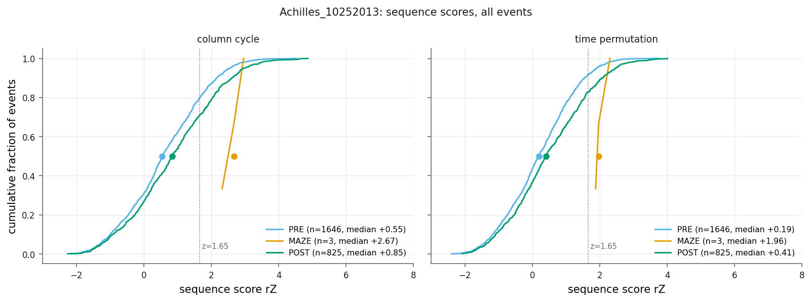
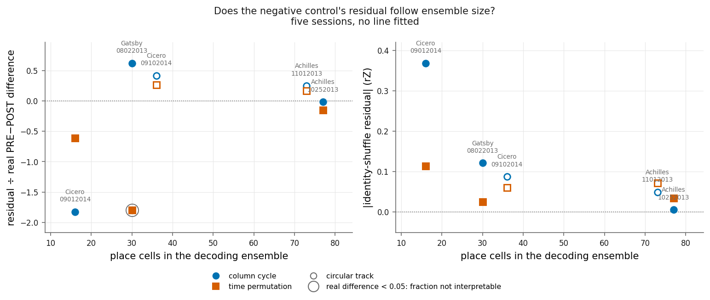
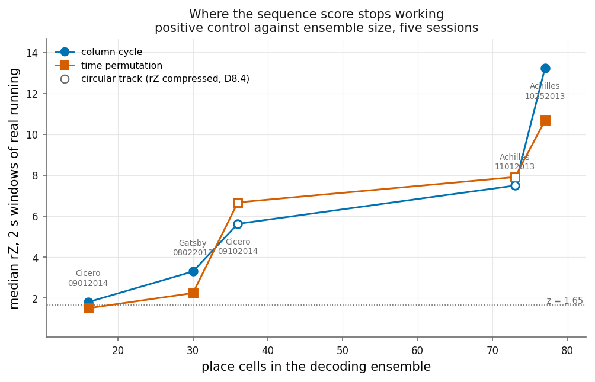
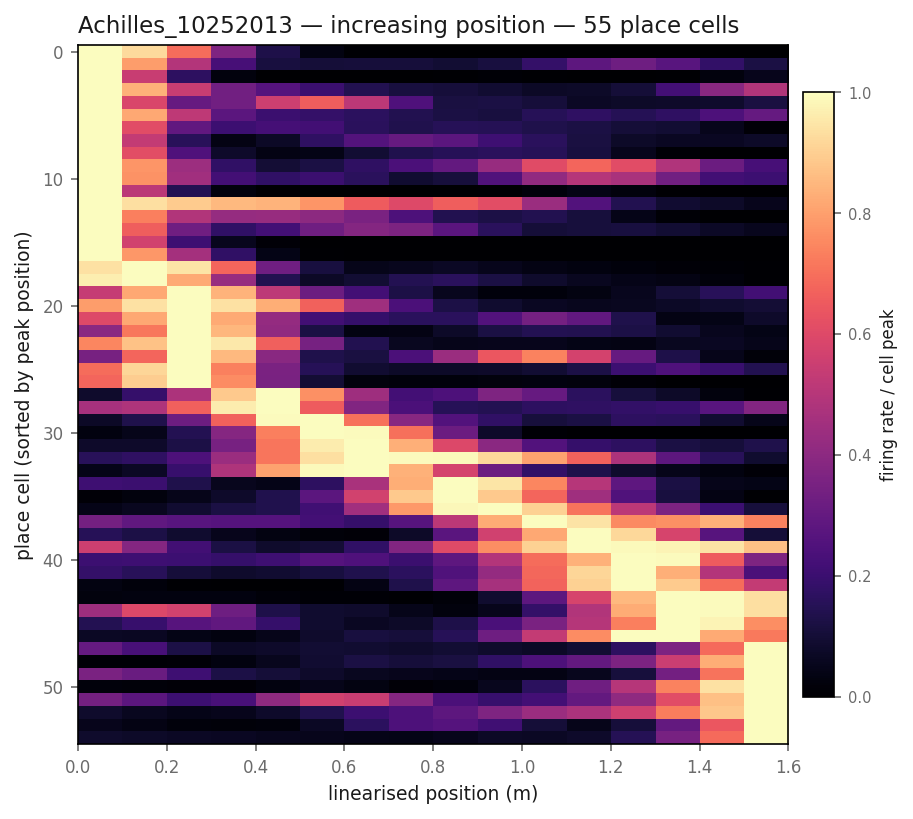
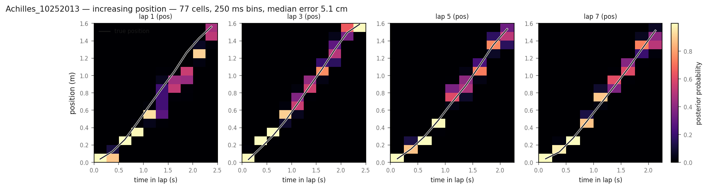
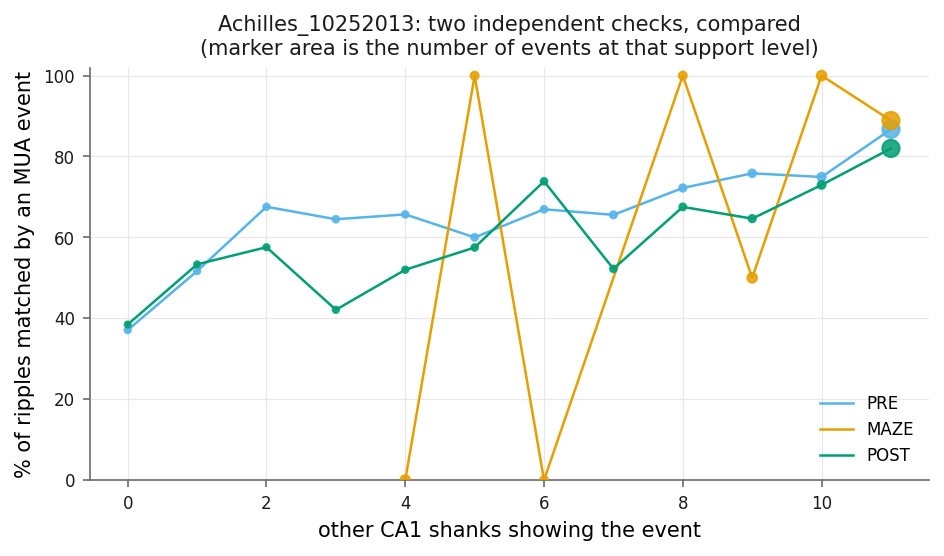

# hc11-place-fields

An independent replication of the hippocampal replay analysis in **Grosmark & Buzsáki
(2016)**, built from scratch in Python against the public CRCNS **hc-11** dataset — from
raw MATLAB session files through place fields, a Bayesian position decoder and
candidate-event detection, to the sequence-score distributions of the paper's Figure 1C.

**The direction of the published effect replicates: sequence scores are higher in
post-experience sleep than in pre-experience sleep, in every session analysed, under both
shuffle procedures and both candidate-event definitions — twenty comparisons out of
twenty.** The magnitude is not established: the effect is small, the paper reports no
comparable effect size, the method's sensitivity varies nearly tenfold across these
sessions, and a negative control leaves a substantial residual in three of the five.

**Five of the eight hc-11 sessions are analysed** — Achilles_10252013, Achilles_11012013,
Cicero_09012014, Cicero_09102014 and Gatsby_08022013. Buddy_06272013, Cicero_09172014 and
Gatsby_08282013 are omitted because their local field potential recordings were not
downloaded, for local storage reasons rather than anything in the data or the method. All
eight sessions contribute to the place-field and decoding stages; only five reach
candidate-event detection, which needs the LFP. This is five of eight, not "the dataset".



*Sequence score (rZ) for candidate events in Achilles_10252013 — one of the five sessions, all of which are tabulated below — by epoch. POST sleep
(green) sits to the right of PRE sleep (blue) across the whole distribution, not only in
the tail. The two panels are two different shuffle procedures; both are reported because
they answer different questions (see below). MAZE has only three scorable events and is
shown for completeness.*

---

## Abbreviations

| | |
|---|---|
| **CA1** | *cornu ammonis* field 1, the hippocampal subregion recorded here |
| **LFP** | local field potential — the low-frequency extracellular voltage |
| **MUA** | multi-unit activity — here, the summed firing rate of the recorded population |
| **NREM** | non-rapid-eye-movement sleep |
| **SPW-R** | sharp-wave ripple, a 150–300 Hz LFP transient accompanying population bursts |
| **rZ** | the sequence score: a weighted correlation standardised against within-event shuffles |
| **EMG** | electromyogram — neck-muscle activity, recorded alongside the probe |
| **PRE / MAZE / POST** | the three epochs of each session: sleep, track running, sleep |

---

## What was found

Candidate events were detected in each epoch, decoded at 20 ms resolution against the
place fields, and scored by how well decoded position tracks time within the event. The
score is standardised against shuffles of the same event, giving **rZ**.

Median rZ, PRE against POST, every session reported separately. "rb" is the rank-biserial
correlation — an effect size bounded by ±1. "control" is what the same difference becomes
when place fields are detached from the cells that own them (the negative control below):
it belongs beside every effect size, not in a footnote, and on three of these sessions it
is large.

| Session | Event set | Shuffle | PRE | POST | difference | rb | p | control leaves |
|---|---|---|---|---|---|---|---|---|
| Achilles_10252013 (linear) | all | column cycle | +0.548 | +0.850 | **+0.302** | +0.114 | 3.4 × 10⁻⁶ | −0.005 (−2 %) |
| Achilles_10252013 | all | time permutation | +0.188 | +0.407 | **+0.220** | +0.131 | 1.2 × 10⁻⁷ | −0.034 (−15 %) |
| Achilles_10252013 | conjunction | column cycle | +0.529 | +0.873 | **+0.344** | +0.136 | 5.4 × 10⁻⁷ | −0.005 (−2 %) |
| Achilles_10252013 | conjunction | time permutation | +0.188 | +0.438 | **+0.250** | +0.147 | 6.0 × 10⁻⁸ | −0.034 (−13 %) |
| Cicero_09012014 (linear) | all | column cycle | +0.332 | +0.534 | +0.202 | +0.073 | 0.091 | −0.369 |
| Cicero_09012014 | all | time permutation | +0.127 | +0.312 | +0.185 | +0.062 | 0.15 | −0.114 |
| Cicero_09012014 | conjunction | column cycle | +0.264 | +0.622 | **+0.357** | +0.137 | 0.0050 | −0.369 |
| Cicero_09012014 | conjunction | time permutation | −0.006 | +0.346 | **+0.351** | +0.131 | 0.0072 | −0.114 |
| Gatsby_08022013 (linear) | all | column cycle | +0.400 | +0.595 | **+0.195** | +0.110 | 0.0024 | **+0.121 (+62 %)** |
| Gatsby_08022013 | all | time permutation | +0.232 | +0.246 | +0.014 | +0.023 | 0.52 | −0.025 |
| Gatsby_08022013 | conjunction | column cycle | +0.609 | +0.873 | **+0.264** | +0.114 | 0.0071 | **+0.121 (+46 %)** |
| Gatsby_08022013 | conjunction | time permutation | +0.258 | +0.406 | +0.148 | +0.077 | 0.068 | −0.025 |
| Achilles_11012013 (circular) | all | column cycle | +0.110 | +0.307 | **+0.197** | +0.071 | 0.026 | **+0.049 (+25 %)** |
| Achilles_11012013 | all | time permutation | +0.291 | +0.723 | **+0.433** | +0.178 | 3.1 × 10⁻⁸ | **+0.071 (+16 %)** |
| Achilles_11012013 | conjunction | column cycle | +0.129 | +0.350 | **+0.221** | +0.091 | 0.0091 | **+0.049 (+22 %)** |
| Achilles_11012013 | conjunction | time permutation | +0.251 | +0.776 | **+0.525** | +0.189 | 6.4 × 10⁻⁸ | **+0.071 (+14 %)** |
| Cicero_09102014 (circular) | all | column cycle | −0.011 | +0.197 | +0.209 | +0.058 | 0.067 | **+0.087 (+42 %)** |
| Cicero_09102014 | all | time permutation | +0.265 | +0.495 | **+0.230** | +0.068 | 0.030 | **+0.060 (+26 %)** |
| Cicero_09102014 | conjunction | column cycle | +0.121 | +0.270 | +0.149 | +0.019 | 0.61 | **+0.087 (+59 %)** |
| Cicero_09102014 | conjunction | time permutation | +0.272 | +0.509 | **+0.237** | +0.084 | 0.020 | **+0.060 (+25 %)** |

**Every one of the twenty differences is positive.** Twelve of the twenty reach p < 0.05
— 3, 3, 4 and 4 of the five sessions in the four columns of the summary below — and the
eight that do not are named rather than averaged away: Cicero_09012014's two full-set
tests, Cicero_09102014's conjunction column-cycle test (rank-biserial +0.019, p = 0.61),
and Gatsby_08022013's full-set time-permutation test (difference +0.014, p = 0.52).

| Event set | Shuffle | sessions with POST > PRE | of those, p < 0.05 |
|---|---|---|---|
| all | column cycle | **5 / 5** | 3 |
| all | time permutation | **5 / 5** | 3 |
| conjunction | column cycle | **5 / 5** | 4 |
| conjunction | time permutation | **5 / 5** | 4 |

Absolute rZ is **not comparable between linear and circular tracks**: on a ring the
weighted correlation is maximised over 28–29 circular offsets of the position axis where a
line offers one, which broadens the null and compresses rZ for the same quality of
sequence (D8.4). Magnitudes are therefore pooled only within a geometry; what is pooled
across all five is the direction, because a sign has no scale.

| Pool | Event set | Shuffle | PRE | POST | difference | rb | p |
|---|---|---|---|---|---|---|---|
| linear (3 sessions) | all | column cycle | +0.493 | +0.728 | +0.235 | +0.088 | 1.1 × 10⁻⁶ |
| linear | all | time permutation | +0.206 | +0.342 | +0.137 | +0.083 | 4.2 × 10⁻⁶ |
| linear | conjunction | column cycle | +0.520 | +0.818 | +0.298 | +0.116 | 1.3 × 10⁻⁸ |
| linear | conjunction | time permutation | +0.198 | +0.407 | +0.209 | +0.120 | 4.5 × 10⁻⁹ |
| circular (2 sessions) | all | column cycle | +0.058 | +0.256 | +0.198 | +0.055 | 0.013 |
| circular | all | time permutation | +0.280 | +0.565 | +0.285 | +0.112 | 4.6 × 10⁻⁷ |
| circular | conjunction | column cycle | +0.126 | +0.303 | +0.177 | +0.050 | 0.045 |
| circular | conjunction | time permutation | +0.268 | +0.601 | +0.333 | +0.126 | 4.2 × 10⁻⁷ |

Where PRE holds more events than POST — the two Achilles sessions and Gatsby_08022013; in
both Cicero sessions POST is the larger set — the test is repeated 200 times with PRE cut
at random to POST's event count. The median matched-n difference lands within 0.01 of the
full-sample difference in eleven of those twelve comparisons (the twelfth, Gatsby's
conjunction time permutation, is 0.025 lower), and the share of draws reaching
p < 0.05 is 100 % in seven of them, 93–98 % in two, **77 %** for Achilles_11012013's
full-set column cycle, **21 %** for Gatsby_08022013's conjunction time permutation and
**0 %** for its full-set time permutation — the same non-result stated a second way.

A rank-biserial correlation of +0.02 to +0.19 means that **if you draw one PRE event and
one POST event at random, the POST event scores higher 51–59 % of the time.** That is a
real shift and a consistent one, but it is not a large one.

Normalising by searched time rather than by event changes nothing about the direction —
20 / 20 again — and the amount of sleep searched is not a constant: POST holds roughly half
the non-REM of PRE in the Achilles sessions but **more** than PRE in Cicero_09102014 (138.9
against 92.8 minutes).

| Session | Shuffle | PRE | POST |
|---|---|---|---|
| Achilles_10252013 | column cycle | 2.01 significant events/min | 2.69 /min |
| Achilles_10252013 | time permutation | 0.83 /min | 1.58 /min |
| Achilles_11012013 | column cycle | 0.45 /min | 0.81 /min |
| Achilles_11012013 | time permutation | 0.70 /min | 1.72 /min |
| Cicero_09012014 | column cycle | 0.47 /min | 0.88 /min |
| Cicero_09012014 | time permutation | 0.19 /min | 0.49 /min |
| Cicero_09102014 | column cycle | 0.39 /min | 0.40 /min |
| Cicero_09102014 | time permutation | 0.56 /min | 0.81 /min |
| Gatsby_08022013 | column cycle | 1.36 /min | 1.87 /min |
| Gatsby_08022013 | time permutation | 0.69 /min | 0.85 /min |

Cicero_09102014's column-cycle margin — 0.396 against 0.388 per minute — is the thinnest
in the set and is quoted at that precision deliberately.

**Why the magnitude cannot be compared to the paper.** Grosmark & Buzsáki report the
Figure 1C distributions graphically and give no effect size, no median rZ, and no
event-count denominator, so there is no published number to compare ours against. Two
further obstacles are ours rather than theirs: only 15–24 % of our candidate events are
long enough to score, and the absolute level of rZ carries a bias that makes
"fraction of events above threshold" meaningless here. Both are described below.

Forward and reverse traversals split evenly (45–53 % forward in every sleep epoch of every
session) with no consistent difference in score between them.

---

## How we know it is not an artifact

A sequence score can look impressive for reasons that have nothing to do with replay, so
the result rests on two controls run through the identical pipeline.

### Negative control: place fields detached from the cells that own them

Permuting which cell owns which place field leaves everything else untouched — the same
events, the same bins, the same spikes, the same shuffles — and destroys the only thing
that could carry replay. If the PRE/POST difference survives that, it is a property of
the event sets or of the scoring, not of the hippocampus.

| Session | geometry | Shuffle | POST − PRE, real fields | identities permuted | residual as % of real |
|---|---|---|---|---|---|
| Achilles_10252013 | linear | column cycle | **+0.302** | −0.005 | −2 % |
| Achilles_10252013 | linear | time permutation | **+0.220** | −0.034 | −15 % |
| Cicero_09012014 | linear | column cycle | +0.202 | −0.369 | −183 % |
| Cicero_09012014 | linear | time permutation | +0.185 | −0.114 | −61 % |
| **Gatsby_08022013** | linear | column cycle | **+0.195** | **+0.121** | **+62 %** |
| Gatsby_08022013 | linear | time permutation | +0.014 | −0.025 | −180 % |
| Achilles_11012013 | circular | column cycle | **+0.197** | **+0.049** | **+25 %** |
| Achilles_11012013 | circular | time permutation | **+0.433** | **+0.071** | **+16 %** |
| Cicero_09102014 | circular | column cycle | +0.209 | **+0.087** | **+42 %** |
| Cicero_09102014 | circular | time permutation | +0.230 | **+0.060** | **+26 %** |

**This is the weakest part of the result and it is reported as such** (D8.8). In two
sessions the gap collapses to nothing. In three it does not:

- **Both circular sessions** leave +16 % to +42 % in all four of their readings. No
  circular effect size should be read without that number attached, and the likely
  mechanism is the same one that compresses circular rZ — maximising the correlation over
  28–29 position offsets gives the permuted data more freedom to find apparent structure.
- **Gatsby_08022013 is a linear track and leaves the largest residual of all**, +0.121
  against a real gap of +0.195. So geometry is not a sufficient explanation. Whether the
  circular residual and the circular rZ compression share a cause is an **open question**;
  five sessions, with ensemble size, event count and geometry all varying together, cannot
  separate them.
- **Two of these percentages are uninterpretable**, and are shown rather than hidden:
  Gatsby's −180 % is −0.025 against a real difference of +0.014 (a session with no effect
  on that shuffle), and Cicero_09012014's −183 % is a percentage of a difference the
  control sends the *other* way, which is reassuring in sign and meaningless in size.

**The residual may be the same finding as the sensitivity floor below.** Plotted against
place-cell count rather than against session identity, it orders by ensemble size and not
by geometry:



*Left: the residual as a fraction of the real PRE/POST difference. Right: the absolute
residual in rZ units, which has no denominator. Hollow markers are circular tracks; the
ringed point has a real difference of +0.014, so its fraction is noise over noise. No
curve is fitted.*

Two readings (D8.10). The signed fraction rises across the four largest ensembles — 77,
73, 36, 30 cells — and those four alternate linear, circular, circular, linear, so cell
count orders them and geometry does not; the smallest ensemble then reverses the sign.
The **absolute** residual is monotone across all five, 0.005 → 0.049 → 0.087 → 0.121 →
0.369, on the column-cycle shuffle in both event sets: read as a noise measurement rather
than a bias, the negative control gets weaker as the ensemble shrinks, and at 16 place
cells it is noisier than the effect it is controlling. The time-permutation shuffle shows
neither pattern.

**Five sessions cannot establish this and no curve is fitted to them.** It is suggestive,
it does not retire the geometry explanation — both circular sessions still sit above both
large-ensemble linear ones — and the two candidate causes are not separable here, because
the circular pair happens to sit in the middle of the ensemble range. What it does mean is
that this figure and the sensitivity-floor figure below should be read together.

An earlier version of this repository applied an automated pass/fail verdict when the
residual exceeded a quarter of the real difference. That threshold was invented here, has
no external standing, and would have called one session a failure while saying nothing
about a linear session leaving 62 %. It has been removed; the residual is printed and the
judgement is the reader's.

The control also returned something we did not expect and that changes how the result may
be read: **with identities permuted, the median rZ is still +0.59**, not zero. The
column-cycle shuffle spreads posterior mass uniformly across position, so it rewards any
event whose decoded position is merely *localised*, sequence or not — and permuting
identities does not stop a burst of co-firing cells from producing a localised posterior.
So the absolute level of rZ is not interpretable, and nothing in this repository rests on
a count of events exceeding a significance threshold. Only the PRE/POST difference
survives the control, and only that is reported as a result.

### Positive control: score real running the same way

If the scoring cannot recognise a trajectory the animal actually ran, it cannot be
trusted on sleep. Running periods were decoded with leave-one-lap-out templates — fields
built from every lap except the one being scored — and scored identically:

| Session | place cells | geometry | column cycle | time permutation |
|---|---|---|---|---|
| Achilles_10252013 | 77 | linear | **+13.23** (95 % above z = 1.65) | **+10.68** (94 %) |
| Achilles_11012013 | 73 | circular | **+7.50** (82 %) | **+7.91** (85 %) |
| Cicero_09102014 | 36 | circular | **+5.63** (91 %) | **+6.67** (96 %) |
| Gatsby_08022013 | 30 | linear | **+3.30** (69 %) | **+2.24** (61 %) |
| Cicero_09012014 | 16 | linear | **+1.80** (52 %) | **+1.50** (46 %) |

A known trajectory scores an order of magnitude above anything seen in sleep — in the
sessions with the largest ensembles. In the smallest it barely scores at all.



*The same table as a figure. Median rZ for 2 s windows of real running against the number
of place cells in the session's decoding ensemble; circular sessions hollow, because rZ is
not comparable across geometry. With 16 place cells the scoring still recognises a known
trajectory, but half its windows fall below z = 1.65.*

**This is the context every effect size on this page needs.** These windows are the one
case where the ground truth is known: the animal ran the trajectory and the decoder
recovers it, so a score near zero is a failure of the scoring, not an absence of sequence.
The method's power varies by nearly an order of magnitude across sessions that the pipeline
otherwise treats identically, which means a replay effect size from Cicero_09012014 and one
from Achilles_10252013 are not measurements on the same instrument. Ensemble size and
geometry are confounded here — the circular sessions sit in the middle at 73 and 36 cells —
so the figure is a floor, not a calibration curve, and nothing in this repository corrects
one session's rZ by another's.

The short-window rows below are the same control at 0.2 s, and they are not a failure:

| Session | Window | Shuffle | n | median rZ | above z = 1.65 |
|---|---|---|---|---|---|
| Achilles_10252013 | 0.2 s | column cycle | 984 | −0.10 | 11 % |
| Achilles_11012013 | 0.2 s | column cycle | 1606 | −0.67 | 2 % |
| Gatsby_08022013 | 0.2 s | column cycle | 1352 | +0.01 | 16 % |

They are the reason both window lengths are reported. At roughly 30 cm/s, 200 ms of running covers about 6 cm — less than one 10 cm
position bin. Such a window cannot contain a trajectory however good the decoder is, so a
low score there measures nothing. That sleep events of that duration score at all is the
point: replay is time-compressed, so 60 ms of replay traverses what takes the animal a
second or more. It also fixes the method's ceiling — a sequence is only visible when the
decoded position actually moves between bins.

---

## The pipeline

Each stage has a module in `src/hc11/`, a command-line script in `scripts/`, and its
parameters in `config/params.yaml`. [`docs/METHODS.md`](docs/METHODS.md) is the full
narrative version; this is the two-minute walkthrough.

**1. Load.** `hc11.io` reads the per-session MATLAB v7.3 files into an immutable
`Session` holding spikes, cluster identities, position, epochs and scored sleep states.
The loader never modifies what it reads; anomalies are reported by `hc11.validate` as
severity-tagged issues and resolved in a separate analysis layer (`hc11.preprocess`), so
a reader can always tell data from decision. Every field is documented in
[`docs/data_schema.md`](docs/data_schema.md).

**2. Behaviour and place fields.** `hc11.behavior` and `hc11.laps` define running periods
and segment them into laps; `hc11.fields` builds directional rate maps, smoothing
occupancy and spike counts separately before dividing, and classifies place cells by
spatial information against a circular-shift shuffle, field detection and split-half
stability. **304 place cells** across the eight sessions.



*Place-field rate maps for one session and one running direction, each cell normalised to
its own peak and the cells sorted by where that peak falls. The staircase is the signature
of a population tiling the track.*

**3. Decoder.** `hc11.decode` implements the memoryless Poisson decoder,
`log P(x | n) = Σᵢ nᵢ log fᵢ(x) − Δ Σᵢ fᵢ(x)`, normalised in log space. Validated by
decoding each lap against fields built from every *other* lap: **median error 4.7–10.6 cm**
across the eight sessions against a chance baseline of 36–71 cm.



*Decoded posterior against the animal's true position for example laps. The decoder is
cross-validated — the fields used here were built without the lap being decoded.*

**4. Candidate events.** Two independent detectors, sharing one two-threshold rule in
`hc11.events` so their outputs are directly comparable. `hc11.mua` detects population
synchrony from spikes alone; `hc11.ripples` detects 150–300 Hz sharp-wave ripples on a
CA1 pyramidal-layer channel chosen per shank by `hc11.ripple_channels`. The MUA set is
primary — the LFP is held locally for five of the eight sessions — with the ripple match
carried as a per-event property, so the stricter conjunction of the two is a filter on a
column rather than a second pipeline.



*Two independent checks on the same events. The x axis counts how many other CA1 shanks
show the same ripple-band transient; the y axis is the fraction of those events that the
spike-based detector also found. The two agree about which events are weak — 37 % at zero
support rising to 87 % at eleven — which is the main evidence that the low-support events
are a real category rather than an artifact of either method.*

**5. Sequence scores.** `hc11.sequences` bins each event at 20 ms, decodes every bin, and
takes the weighted correlation between decoded position and bin index over the whole
posterior, standardised against 500 within-event shuffles of two kinds. No position is
read off the posterior: a bin whose posterior is spread over half the track contributes
its spread, not a point estimate.

---

## Where this diverges from the paper, and what turned up on the way

This section is the reason to trust the rest. None of it was tuned away.

### We find 304 place cells; the paper reports 491

A factor of 1.62, outside the tolerance set at the start, and it is **not** a threshold we
have mis-set. Relaxing our criteria one at a time:

| Variant | Unique place cells | % of 562 pyramidal cells |
|---|---|---|
| **our primary criteria** | **304** | 54 % |
| field-width cap removed | 346 | 62 % |
| cap removed + spike floor lowered to 20 | 367 | 65 % |
| peak rate ≥ 1 Hz and nothing else | 392 | 70 % |
| Grosmark & Buzsáki | 491 | 87 % |

The fourth row is the decisive one. Chen et al. (2016), describing the same recordings,
state that all pyramidal neurons selected for analysis had a peak firing rate above 1 Hz.
Applying *only* that — no field requirement, no shuffle test, no stability criterion, no
spike floor — still yields 392, not 491. There is no setting of our criteria that reaches
87 % of pyramidal cells.

Part of the gap is traceable. The released `OneDLocation` variable marks *being on the
linearised track*, not running, and how strictly it was curated varies by session: it is
defined for only 7–35 % of each MAZE epoch. Rebuilding everything on our own linearisation
of the raw two-dimensional position over all tracked MAZE time widens the base to 68–98 %
and raises the yield from 47 % to 59 % of pyramidal cells on the linear tracks — one
session doubles, the one where the released mask was thinnest at 2.6 minutes of running.
That is a real contributor, but 59 % is still well short of 87 %, and the remainder is
unexplained. The authors' mask remains the base for every primary result, because it is
theirs.

### Absolute rZ is not interpretable

Covered under the negative control above: identity-permuted fields still give a median rZ
of +0.59 under the column-cycle shuffle, because that shuffle rewards positional
localisation as well as sequence. Threshold-crossing fractions are therefore meaningless
in this repository and are never quoted as a result. Only the PRE/POST difference, which
the control collapses to zero, carries information.

### A single-lap directional template cost one session its entire effect

Achilles_11012013 is a circular maze, run in one direction. Its other direction contains
**exactly one lap of 226 position samples**, against 75 laps for the direction the animal
actually ran. A place-field template built from one lap is noise — and because the score
takes the better of the two directions, a noise template hands the *shuffles* the same
extra freedom, raising the null and lowering every event's score. Removing it moved that
session's median rZ from −0.060 to +0.110 in PRE and from +0.148 to +0.307 in POST: a
shift the size of the effect being measured, from a template nobody would have defended
if asked. Directions now need five laps before their fields are used.

### Only 15–24 % of candidate events are long enough to score

Scoring needs at least five 20 ms bins with spikes in them, which needs a 100 ms event.
Our events have a median duration of 55–69 ms, and the scorable fraction across the five
sessions is **6–23 %**:

| | median duration | scorable (PRE) | scorable (POST) |
|---|---|---|---|
| Achilles_10252013 | 68 / 62 ms | 1646 of 7046 — **23 %** | 825 of 3955 — **21 %** |
| Achilles_11012013 | 57 / 58 ms | 695 of 4709 — **15 %** | 605 of 3328 — **18 %** |
| Cicero_09012014 | 55 / 56 ms | 310 of 4916 — **6 %** | 435 of 4643 — **9 %** |
| Cicero_09102014 | 60 / 58 ms | 562 of 3812 — **15 %** | 836 of 5923 — **14 %** |
| Gatsby_08022013 | 56 / 58 ms | 671 of 4637 — **14 %** | 408 of 2889 — **14 %** |

Cicero_09012014 is the extreme case, and the reason is its ensemble rather than its
events: with 16 place cells, a 60 ms burst rarely puts spikes from enough of them into
five consecutive bins. It is also the session at the bottom of the sensitivity-floor
figure. Even so, 310 and 435 scorable events are enough to test, and no PRE/POST
comparison in this repository rests on fewer than 100 events in either epoch.

This is a larger loss than every other filter in the pipeline combined, and it traces to
the event detector's boundary threshold rather than to anything in the scoring. It is
recorded rather than tuned: a three-bin floor would mean fitting a correlation to three
points, which is not an estimate. The same filter applies to PRE and POST, so the
comparison is unaffected; what it limits is any absolute rate.

### How much sleep there is to search varies by session, and not in one direction

Searched non-REM minutes, PRE → POST: Achilles_10252013 168.5 → 89.7, Achilles_11012013
104.0 → 73.0, Gatsby_08022013 100.7 → 63.8, Cicero_09012014 112.9 → 106.5, **and
Cicero_09102014 92.8 → 138.9**. The "POST holds half the sleep of PRE" observation from the
two-session stage is an Achilles fact, not a dataset fact: one session has half again as
much non-REM in POST as in PRE. Part of the variation is simply epoch length, part is
proportion (56 % → 37 % in one session) and in one the REM collapses instead (27 % → 5 %
of scored sleep).

Since the denominator moves in both directions, every rate in this repository is
normalised by searched time, and the PRE/POST test is reported both on all events and on
PRE subsampled to POST's event count where PRE is the larger set.

### Quiet wakefulness on the maze cannot be defined from the released position data

Chen et al.'s criterion is speed below 2 cm/s, which yields 0.4 minutes of searchable time
out of 34–45 minutes. This is not a threshold problem: the sub-threshold samples are
turnaround zero-crossings, not pauses, with a median run of 0.18 s. The genuinely quiet
periods are plausibly the 7.6–8.7 minutes of lost tracking, when the animal sits at a
reward site with its head-mounted light out of view — an open hypothesis, not a ruled-out
one, and one the EMG or theta/delta channels of the LFP would settle.

---

## Scope and limitations

- **Five of eight sessions** carry the full analysis: Achilles_10252013,
  Achilles_11012013, Cicero_09012014, Cicero_09102014 and Gatsby_08022013, from three of
  the four animals. Steps 1–5 (loading through decoding) run on all eight; event detection
  and sequence scoring need the LFP, which is roughly 9.5 GB compressed per session.
  **Buddy_06272013, Cicero_09172014 and Gatsby_08282013 are omitted because that LFP was
  not downloaded, for local storage reasons** — not because of anything in the data, and
  not because they failed anything. The place-cell total of 304 is still all eight
  sessions. Omitting Gatsby_08282013 and Buddy_06272013 has one methodological
  consequence, recorded below.
- **The Science paper's methods are in an online supplement that was not available.**
  Parameters came from Chen et al. (2016) where that paper states one, and are otherwise
  our own choice, labelled **provisional** in `config/params.yaml` with the reasoning in
  `docs/decisions.md`.
- **Every session is reported separately as the primary result.** Pooling is secondary and
  happens only *within* a track geometry, because rZ is not on the same scale on a ring as
  on a line (D8.4). Five sessions with place-cell ensembles from 16 to 77 are an internal
  replication, not a sample.
- **The method's sensitivity varies nearly tenfold across these five sessions** — the
  positive control runs from +13.2 to +1.8 — so the effect sizes are not measurements on a
  common instrument, and no attempt is made to correct for that.
- **The negative control leaves a substantial residual in three of the five sessions**
  (both circular, and one linear), which is the main reason the magnitude is reported as
  unestablished. See D8.8.
- **No session in this analysis exercises the XML `skip="1"` channel flag.** The two
  sessions whose metadata carries it, Buddy_06272013 and Gatsby_08282013, are the omitted
  ones; Gatsby_08022013 excludes its bad channel by a different mechanism (absence from a
  `spikeDetection` group). The skip-flag parser is covered by unit tests and by no real
  session.
- Nothing here addresses the paper's rigid-versus-plastic cell classification or its
  per-cell contribution scores. The replication stops at Figure 1C.

---

## Reproducing it

### Install

[uv](https://docs.astral.sh/uv/), Python ≥ 3.10:

```bash
uv sync --extra dev
uv run pytest
```

Or with pip: `python -m venv .venv && source .venv/bin/activate && pip install -e ".[dev]" && pytest`.

> This repository lives in a synced folder in its original location, and a virtual
> environment is thousands of small files. `.venv/` is gitignored; if sync churn becomes a
> problem, put the environment elsewhere with
> `export UV_PROJECT_ENVIRONMENT=~/.venvs/hc11`.

### Get the data

The raw data is not in this repository and never will be. Register at
<https://crcns.org/> and request the [hc-11](https://crcns.org/data-sets/hc/hc-11)
dataset, then download:

| File | Size | Needed for |
|---|---|---|
| `NoveltySessInfoMatFiles.tar.gz` | ~290 MB | everything |
| `Channel_Orderings.pdf`, `Sessions_Recordings_Summary.pdf` | small | verifying the probe layout |
| `<session>_eeg.tar.gz` | ~9.5 GB each | ripple detection only (steps 6–7) |

Extract the session files to `data/raw/NoveltySessInfoMatFiles/`, or point at them:

```bash
export HC11_DATA_DIR=/path/to/NoveltySessInfoMatFiles   # → data/raw/... → ../hc-11_Data/...
export HC11_LFP_DIR=/path/to/lfp                        # → data/raw/lfp → ../hc-11_LFP
```

The LFP directory needs both `<session>.eeg` and `<session>.xml` per session, flat or in
per-session subfolders; without the XML the binary cannot be indexed at all. CRCNS ships
each recording as a gzipped tarball, and `hc11.eeg_archive` unpacks it: it reads the
uncompressed size from the tar header so the file-size check can run before the
extraction starts, and it is resumable, because a 12 GB write does not always finish in
one go. Check the setup with `python -m hc11.config`.

### Run it

```bash
uv run python scripts/inspect_sessions.py --warnings   # per-session overview and QC
uv run python scripts/place_fields.py                  # place fields, all 8 sessions   ~40 s
uv run python scripts/decode_position.py               # cross-validated decoding       ~1 min
uv run python scripts/detect_mua_events.py             # population-synchrony events
uv run python scripts/mua_jitter_null.py               # is the synchrony real?
uv run python scripts/select_ripple_channels.py        # LFP: one channel per shank     ~1 min
uv run python scripts/detect_ripples.py                # sharp-wave ripples             ~2 min
uv run python scripts/cross_check_events.py            # ripples against MUA
uv run python scripts/characterise_events.py           # event properties, decodability
uv run python scripts/score_events.py                  # sequence scores                ~15 s
uv run python scripts/score_events.py --identity-shuffle   # the negative control
uv run python scripts/validate_sequences.py            # both controls
uv run python scripts/replay_comparison.py             # the Fig. 1C comparison
uv run python scripts/sensitivity_floor.py             # the positive control as a figure
uv run python scripts/residual_vs_ensemble.py          # residual against ensemble size
```

All of these default to the five sessions whose LFP is present (`config.LFP_SESSIONS`);
`place_fields.py` and `decode_position.py` run on all eight.

Everything lands in `results/` (gitignored): one CSV per analysis and per-session figures,
each figure with a sidecar JSON recording the parameters and the git commit that made it.
The whole pipeline is a few minutes on a laptop once the LFP is extracted; extraction
itself is the slow part, at roughly three minutes per session.

### Tests

```
448 passed, 3 skipped
```

The three skips are a parametrised test that does not apply to circular mazes. **Seventeen
test functions, plus all of `tests/test_data_present.py`, are marked `requires_data` and
skip silently when the hc-11 session files are absent** — so a passing run on a fresh
clone with no data is *not* full coverage. Everything else runs against synthetic
fixtures: HDF5 files built to the same schema, synthetic place fields with known peaks,
posteriors with known correlations, and a 544 MB LFP fixture that checks a one-second read
touches under 10 kB.

---

## Layout

```
src/hc11/        the package: loader, behaviour, fields, decoder, events, ripples, sequences
config/          params.yaml — every tunable number, with its provenance
scripts/         command-line entry points; each writes to results/
tests/           pytest suite, synthetic fixtures plus data-dependent checks
docs/            METHODS.md, decisions.md (the decision log), worklog.md, data_schema.md
results/         generated figures and tables (gitignored)
data/            raw data (gitignored)
```

`docs/decisions.md` records every methodological choice with its reasoning, numbered
D1.1 through D8.9 and cross-referenced from `docs/METHODS.md`. `docs/worklog.md` is the
running diary, including what went wrong and when.

---

## Citations

> Grosmark, A. D. & Buzsáki, G. (2016). Diversity in neural firing dynamics supports both
> rigid and learned hippocampal sequences. *Science* **351**(6280), 1440–1443.
> doi:[10.1126/science.aad1935](https://doi.org/10.1126/science.aad1935)

> Chen, Z., Grosmark, A. D., Penagos, H. & Wilson, M. A. (2016). Uncovering representations
> of sleep-associated hippocampal ensemble spike activity. *Scientific Reports* **6**,
> 32193. doi:[10.1038/srep32193](https://doi.org/10.1038/srep32193)

> Grosmark, A. D., Long, J. & Buzsáki, G. (2016). Recordings from hippocampal area CA1,
> PRE, during and POST novel spatial learning. CRCNS.org.
> doi:[10.6080/K0862DC5](https://doi.org/10.6080/K0862DC5)

## License

Code: MIT, see `LICENSE`. The hc-11 dataset is not covered by that license and remains
subject to the CRCNS data-sharing terms.
