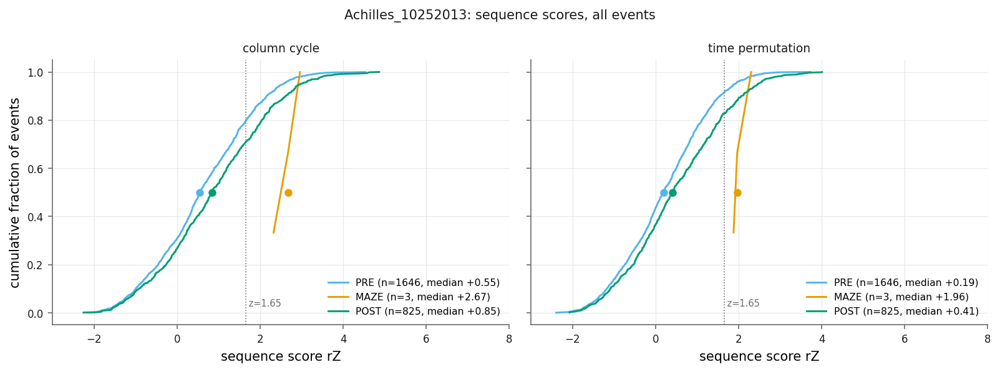
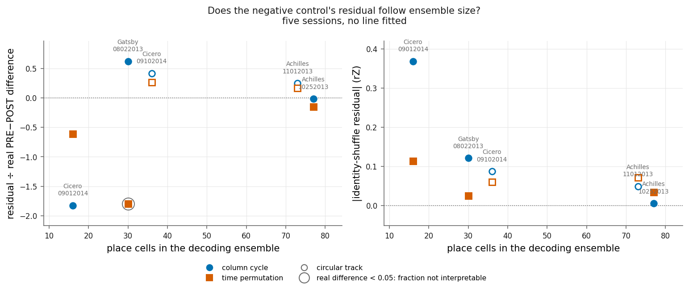
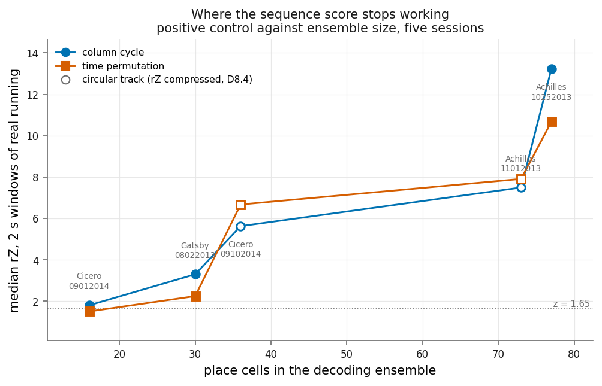
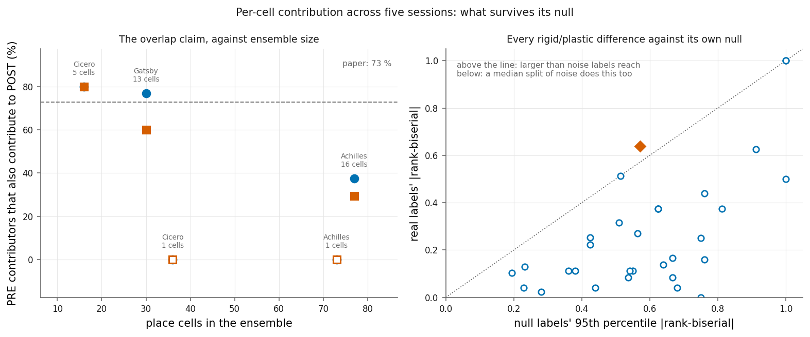
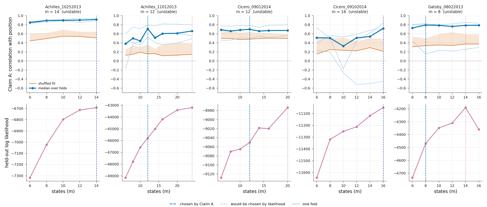
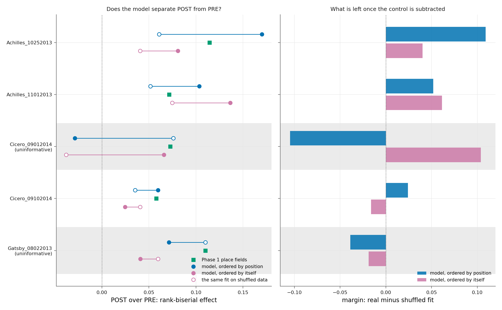
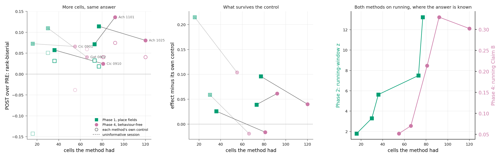
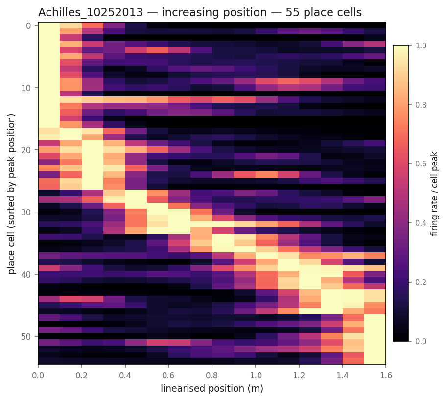
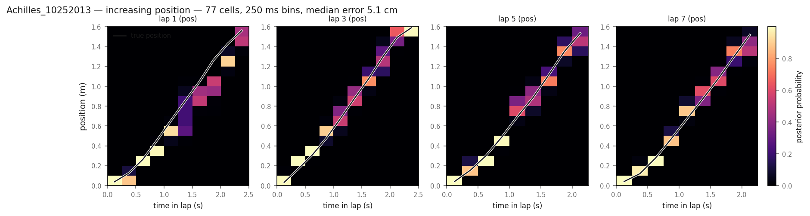
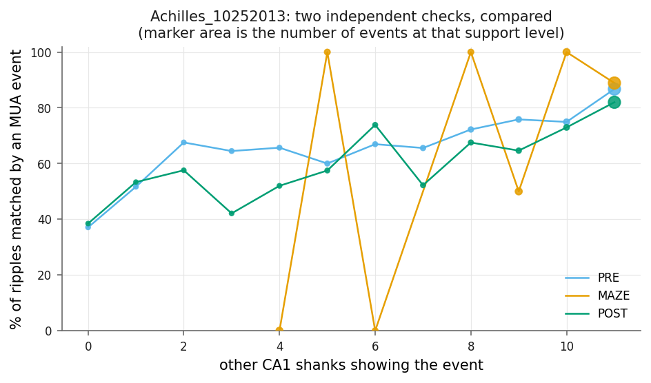

# hc11-place-fields

An independent replication of **Grosmark & Buzsáki (2016)**, *Science* **351**:1440, built
from scratch in Python against the public CRCNS **hc-11** dataset — from raw MATLAB session
files through place fields, a Bayesian position decoder and candidate-event detection, to
the sequence-score distributions of the paper's Figure 1C and the per-cell analysis behind
its Figures 2 to 4 — and then, in a fourth phase, the same replay question asked again with
a method that never sees the animal's position at all (Chen, Grosmark, Penagos & Wilson,
2016, *Sci Rep* **6**:32193).

## The arc, in one minute

**Phase 1 — the published effect replicates in direction.** Sequence scores are higher in
post-experience sleep than in pre-experience sleep, in every session analysed, under both
shuffle procedures and both candidate-event definitions: **twenty comparisons out of
twenty**, and twenty again when the denominator is searched sleep rather than events. The
magnitude is not established — the paper reports Figure 1C graphically with no effect size
or denominator, so there is no published number to compare against.

**Phase 2 — the method has a sensitivity floor, and it is not far below the effect.** A
positive control that scores real running, where the answer is known, runs from **+13.2 at
77 place cells to +1.8 at 16**, where half the windows fall below threshold. A negative
control that detaches place fields from the cells that own them leaves a substantial
residual in three of the five sessions. The effect sizes are therefore not measurements on
a common instrument, and the floor is close enough to the signal to matter.

**Phase 3 — the per-cell structure is below what these ensembles can resolve.** The paper's
per-cell contribution score, reconstructed and run on all five sessions, recovers the
population effect additively but cannot support the rigid/plastic split built on top of it:
of 32 rigid-versus-plastic comparisons, **one** exceeds what the same estimator produces
from fields carrying no positional information, and that one ties rather than beats its
null and runs in the opposite direction to the paper. Three of the five sessions cannot
test the split at all.

**What Phase 3 is not.** It is not a refutation. Grosmark & Buzsáki had 491 cells across
eight sessions and their own methods; this project has 77 cells in its best session and a
procedure reconstructed from four sentences of main text and one figure caption. The claim
here is narrower and it is a claim about measurement: **this estimator, on these ensembles,
cannot resolve the per-cell structure the paper reports** — and two calibration floors say
by how much it falls short. A reader who takes Phase 3 as evidence that the paper is wrong
is taking more from it than the data supports.

**Phase 4 — a method that needs no place fields works where the data is already good, and
does not rescue the sessions where it is not.** A hidden Markov model fitted to population
spiking alone, with no behavioural measure anywhere in the fit, recovers position on
running (circular correlation 0.70–0.91) and separates post-sleep from pre-sleep events on
the two largest ensembles — **+0.081 and +0.136 rank-biserial, against its own control's
+0.041 and +0.075**. Those are the two sessions where place fields already worked. The
model had 1.3–3.4× more cells than the place-field decoder on every session and the extra
cells bought nothing on the three below Phase 2's floor: two of those cannot test the
question at all on their own running control, and the third is a negative.

**What Phase 4 is and is not.** The result is real and it is narrow: on the best-powered
sessions, replay can be read without receptive fields, at about twice what the same model
fitted to shuffled data achieves on the same events. It is not an order of magnitude, it is
not five sessions, and it comes with an unexplained caveat — on four of five sessions a
model fitted to **shuffled** spike trains also decodes position and also separates POST
from PRE. Two mechanisms for that were proposed, tested and rejected. Every number in Phase
4 is reported against that control rather than against zero.

**Scope.** Five of the eight hc-11 sessions are analysed — Achilles_10252013,
Achilles_11012013, Cicero_09012014, Cicero_09102014 and Gatsby_08022013. Buddy_06272013,
Cicero_09172014 and Gatsby_08282013 are omitted because their local field potential
recordings were not downloaded, for local storage reasons rather than anything in the data
or the method. All eight contribute to the place-field and decoding stages; only five reach
candidate-event detection, which needs the LFP. This is five of eight, never "the dataset".

---

## Abbreviations

| | |
|---|---|
| **CA1** | *cornu ammonis* field 1, the hippocampal subregion recorded here |
| **LFP** | local field potential — the low-frequency extracellular voltage |
| **MUA** | multi-unit activity — here, the summed firing rate of the recorded population |
| **NREM** | non-rapid-eye-movement sleep |
| **SPW-R** | sharp-wave ripple, a 150–300 Hz LFP transient accompanying population bursts |
| **rZ** | the sequence score: a weighted correlation standardised against within-event shuffles |
| **EMG** | electromyogram — neck-muscle activity, recorded alongside the probe |
| **PRE / MAZE / POST** | the three epochs of each session: sleep, track running, sleep |
| **HMM** | hidden Markov model — here, one whose states are fitted to population spiking |
| **EM** | expectation-maximisation, the algorithm used to fit it |

---

## Phase 1: does the published effect replicate?



*Sequence score (rZ) for candidate events in Achilles_10252013 — one of the five sessions, all of which are tabulated below — by epoch. POST sleep
(green) sits to the right of PRE sleep (blue) across the whole distribution, not only in
the tail. The two panels are two different shuffle procedures; both are reported because
they answer different questions (see below). MAZE has only three scorable events and is
shown for completeness.*

---


Candidate events were detected in each epoch, decoded at 20 ms resolution against the
place fields, and scored by how well decoded position tracks time within the event. The
score is standardised against shuffles of the same event, giving **rZ**.

Median rZ, PRE against POST, every session reported separately. "rb" is the rank-biserial
correlation — an effect size bounded by ±1. "control" is what the same difference becomes
when place fields are detached from the cells that own them (the negative control below):
it belongs beside every effect size, not in a footnote, and on three of these sessions it
is large.

| Session | Event set | Shuffle | PRE | POST | difference | rb | p | control leaves |
|---|---|---|---|---|---|---|---|---|
| Achilles_10252013 (linear) | all | column cycle | +0.548 | +0.850 | **+0.302** | +0.114 | 3.4 × 10⁻⁶ | −0.005 (−2 %) |
| Achilles_10252013 | all | time permutation | +0.188 | +0.407 | **+0.220** | +0.131 | 1.2 × 10⁻⁷ | −0.034 (−15 %) |
| Achilles_10252013 | conjunction | column cycle | +0.529 | +0.873 | **+0.344** | +0.136 | 5.4 × 10⁻⁷ | −0.005 (−2 %) |
| Achilles_10252013 | conjunction | time permutation | +0.188 | +0.438 | **+0.250** | +0.147 | 6.0 × 10⁻⁸ | −0.034 (−13 %) |
| Cicero_09012014 (linear) | all | column cycle | +0.332 | +0.534 | +0.202 | +0.073 | 0.091 | −0.369 |
| Cicero_09012014 | all | time permutation | +0.127 | +0.312 | +0.185 | +0.062 | 0.15 | −0.114 |
| Cicero_09012014 | conjunction | column cycle | +0.264 | +0.622 | **+0.357** | +0.137 | 0.0050 | −0.369 |
| Cicero_09012014 | conjunction | time permutation | −0.006 | +0.346 | **+0.351** | +0.131 | 0.0072 | −0.114 |
| Gatsby_08022013 (linear) | all | column cycle | +0.400 | +0.595 | **+0.195** | +0.110 | 0.0024 | **+0.121 (+62 %)** |
| Gatsby_08022013 | all | time permutation | +0.232 | +0.246 | +0.014 | +0.023 | 0.52 | −0.025 |
| Gatsby_08022013 | conjunction | column cycle | +0.609 | +0.873 | **+0.264** | +0.114 | 0.0071 | **+0.121 (+46 %)** |
| Gatsby_08022013 | conjunction | time permutation | +0.258 | +0.406 | +0.148 | +0.077 | 0.068 | −0.025 |
| Achilles_11012013 (circular) | all | column cycle | +0.110 | +0.307 | **+0.197** | +0.071 | 0.026 | **+0.049 (+25 %)** |
| Achilles_11012013 | all | time permutation | +0.291 | +0.723 | **+0.433** | +0.178 | 3.1 × 10⁻⁸ | **+0.071 (+16 %)** |
| Achilles_11012013 | conjunction | column cycle | +0.129 | +0.350 | **+0.221** | +0.091 | 0.0091 | **+0.049 (+22 %)** |
| Achilles_11012013 | conjunction | time permutation | +0.251 | +0.776 | **+0.525** | +0.189 | 6.4 × 10⁻⁸ | **+0.071 (+14 %)** |
| Cicero_09102014 (circular) | all | column cycle | −0.011 | +0.197 | +0.209 | +0.058 | 0.067 | **+0.087 (+42 %)** |
| Cicero_09102014 | all | time permutation | +0.265 | +0.495 | **+0.230** | +0.068 | 0.030 | **+0.060 (+26 %)** |
| Cicero_09102014 | conjunction | column cycle | +0.121 | +0.270 | +0.149 | +0.019 | 0.61 | **+0.087 (+59 %)** |
| Cicero_09102014 | conjunction | time permutation | +0.272 | +0.509 | **+0.237** | +0.084 | 0.020 | **+0.060 (+25 %)** |

**Every one of the twenty differences is positive.** Twelve of the twenty reach p < 0.05
— 3, 3, 4 and 4 of the five sessions in the four columns of the summary below — and the
eight that do not are named rather than averaged away: Cicero_09012014's two full-set
tests, Cicero_09102014's conjunction column-cycle test (rank-biserial +0.019, p = 0.61),
and Gatsby_08022013's full-set time-permutation test (difference +0.014, p = 0.52).

| Event set | Shuffle | sessions with POST > PRE | of those, p < 0.05 |
|---|---|---|---|
| all | column cycle | **5 / 5** | 3 |
| all | time permutation | **5 / 5** | 3 |
| conjunction | column cycle | **5 / 5** | 4 |
| conjunction | time permutation | **5 / 5** | 4 |

Absolute rZ is **not comparable between linear and circular tracks**: on a ring the
weighted correlation is maximised over 28–29 circular offsets of the position axis where a
line offers one, which broadens the null and compresses rZ for the same quality of
sequence (D8.4). Magnitudes are therefore pooled only within a geometry; what is pooled
across all five is the direction, because a sign has no scale.

| Pool | Event set | Shuffle | PRE | POST | difference | rb | p |
|---|---|---|---|---|---|---|---|
| linear (3 sessions) | all | column cycle | +0.493 | +0.728 | +0.235 | +0.088 | 1.1 × 10⁻⁶ |
| linear | all | time permutation | +0.206 | +0.342 | +0.137 | +0.083 | 4.2 × 10⁻⁶ |
| linear | conjunction | column cycle | +0.520 | +0.818 | +0.298 | +0.116 | 1.3 × 10⁻⁸ |
| linear | conjunction | time permutation | +0.198 | +0.407 | +0.209 | +0.120 | 4.5 × 10⁻⁹ |
| circular (2 sessions) | all | column cycle | +0.058 | +0.256 | +0.198 | +0.055 | 0.013 |
| circular | all | time permutation | +0.280 | +0.565 | +0.285 | +0.112 | 4.6 × 10⁻⁷ |
| circular | conjunction | column cycle | +0.126 | +0.303 | +0.177 | +0.050 | 0.045 |
| circular | conjunction | time permutation | +0.268 | +0.601 | +0.333 | +0.126 | 4.2 × 10⁻⁷ |

Where PRE holds more events than POST — the two Achilles sessions and Gatsby_08022013; in
both Cicero sessions POST is the larger set — the test is repeated 200 times with PRE cut
at random to POST's event count. The median matched-n difference lands within 0.01 of the
full-sample difference in eleven of those twelve comparisons (the twelfth, Gatsby's
conjunction time permutation, is 0.025 lower), and the share of draws reaching
p < 0.05 is 100 % in seven of them, 93–98 % in two, **77 %** for Achilles_11012013's
full-set column cycle, **21 %** for Gatsby_08022013's conjunction time permutation and
**0 %** for its full-set time permutation — the same non-result stated a second way.

A rank-biserial correlation of +0.02 to +0.19 means that **if you draw one PRE event and
one POST event at random, the POST event scores higher 51–59 % of the time.** That is a
real shift and a consistent one, but it is not a large one.

Normalising by searched time rather than by event changes nothing about the direction —
20 / 20 again — and the amount of sleep searched is not a constant: POST holds roughly half
the non-REM of PRE in the Achilles sessions but **more** than PRE in Cicero_09102014 (138.9
against 92.8 minutes).

| Session | Shuffle | PRE | POST |
|---|---|---|---|
| Achilles_10252013 | column cycle | 2.01 significant events/min | 2.69 /min |
| Achilles_10252013 | time permutation | 0.83 /min | 1.58 /min |
| Achilles_11012013 | column cycle | 0.45 /min | 0.81 /min |
| Achilles_11012013 | time permutation | 0.70 /min | 1.72 /min |
| Cicero_09012014 | column cycle | 0.47 /min | 0.88 /min |
| Cicero_09012014 | time permutation | 0.19 /min | 0.49 /min |
| Cicero_09102014 | column cycle | 0.39 /min | 0.40 /min |
| Cicero_09102014 | time permutation | 0.56 /min | 0.81 /min |
| Gatsby_08022013 | column cycle | 1.36 /min | 1.87 /min |
| Gatsby_08022013 | time permutation | 0.69 /min | 0.85 /min |

Cicero_09102014's column-cycle margin — 0.396 against 0.388 per minute — is the thinnest
in the set and is quoted at that precision deliberately.

**Why the magnitude cannot be compared to the paper.** Grosmark & Buzsáki report the
Figure 1C distributions graphically and give no effect size, no median rZ, and no
event-count denominator, so there is no published number to compare ours against. Two
further obstacles are ours rather than theirs: only 15–24 % of our candidate events are
long enough to score, and the absolute level of rZ carries a bias that makes
"fraction of events above threshold" meaningless here. Both are described below.

Forward and reverse traversals split evenly (45–53 % forward in every sleep epoch of every
session) with no consistent difference in score between them.

---

## Phase 2: how much of this can the method see?

A sequence score can look impressive for reasons that have nothing to do with replay, so
the result rests on two controls run through the identical pipeline.

### Negative control: place fields detached from the cells that own them

Permuting which cell owns which place field leaves everything else untouched — the same
events, the same bins, the same spikes, the same shuffles — and destroys the only thing
that could carry replay. If the PRE/POST difference survives that, it is a property of
the event sets or of the scoring, not of the hippocampus.

| Session | geometry | Shuffle | POST − PRE, real fields | identities permuted | residual as % of real |
|---|---|---|---|---|---|
| Achilles_10252013 | linear | column cycle | **+0.302** | −0.005 | −2 % |
| Achilles_10252013 | linear | time permutation | **+0.220** | −0.034 | −15 % |
| Cicero_09012014 | linear | column cycle | +0.202 | −0.369 | −183 % |
| Cicero_09012014 | linear | time permutation | +0.185 | −0.114 | −61 % |
| **Gatsby_08022013** | linear | column cycle | **+0.195** | **+0.121** | **+62 %** |
| Gatsby_08022013 | linear | time permutation | +0.014 | −0.025 | −180 % |
| Achilles_11012013 | circular | column cycle | **+0.197** | **+0.049** | **+25 %** |
| Achilles_11012013 | circular | time permutation | **+0.433** | **+0.071** | **+16 %** |
| Cicero_09102014 | circular | column cycle | +0.209 | **+0.087** | **+42 %** |
| Cicero_09102014 | circular | time permutation | +0.230 | **+0.060** | **+26 %** |

**This is the weakest part of the result and it is reported as such** (D8.8). In two
sessions the gap collapses to nothing. In three it does not:

- **Both circular sessions** leave +16 % to +42 % in all four of their readings. No
  circular effect size should be read without that number attached, and the likely
  mechanism is the same one that compresses circular rZ — maximising the correlation over
  28–29 position offsets gives the permuted data more freedom to find apparent structure.
- **Gatsby_08022013 is a linear track and leaves the largest residual of all**, +0.121
  against a real gap of +0.195. So geometry is not a sufficient explanation. Whether the
  circular residual and the circular rZ compression share a cause is an **open question**;
  five sessions, with ensemble size, event count and geometry all varying together, cannot
  separate them.
- **Two of these percentages are uninterpretable**, and are shown rather than hidden:
  Gatsby's −180 % is −0.025 against a real difference of +0.014 (a session with no effect
  on that shuffle), and Cicero_09012014's −183 % is a percentage of a difference the
  control sends the *other* way, which is reassuring in sign and meaningless in size.

**The residual may be the same finding as the sensitivity floor below.** Plotted against
place-cell count rather than against session identity, it orders by ensemble size and not
by geometry:



*Left: the residual as a fraction of the real PRE/POST difference. Right: the absolute
residual in rZ units, which has no denominator. Hollow markers are circular tracks; the
ringed point has a real difference of +0.014, so its fraction is noise over noise. No
curve is fitted.*

Two readings (D8.10). The signed fraction rises across the four largest ensembles — 77,
73, 36, 30 cells — and those four alternate linear, circular, circular, linear, so cell
count orders them and geometry does not; the smallest ensemble then reverses the sign.
The **absolute** residual is monotone across all five, 0.005 → 0.049 → 0.087 → 0.121 →
0.369, on the column-cycle shuffle in both event sets: read as a noise measurement rather
than a bias, the negative control gets weaker as the ensemble shrinks, and at 16 place
cells it is noisier than the effect it is controlling. The time-permutation shuffle shows
neither pattern.

**Five sessions cannot establish this and no curve is fitted to them.** It is suggestive,
it does not retire the geometry explanation — both circular sessions still sit above both
large-ensemble linear ones — and the two candidate causes are not separable here, because
the circular pair happens to sit in the middle of the ensemble range. What it does mean is
that this figure and the sensitivity-floor figure below should be read together.

An earlier version of this repository applied an automated pass/fail verdict when the
residual exceeded a quarter of the real difference. That threshold was invented here, has
no external standing, and would have called one session a failure while saying nothing
about a linear session leaving 62 %. It has been removed; the residual is printed and the
judgement is the reader's.

The control also returned something we did not expect and that changes how the result may
be read: **with identities permuted, the median rZ is still +0.59**, not zero. The
column-cycle shuffle spreads posterior mass uniformly across position, so it rewards any
event whose decoded position is merely *localised*, sequence or not — and permuting
identities does not stop a burst of co-firing cells from producing a localised posterior.
So the absolute level of rZ is not interpretable, and nothing in this repository rests on
a count of events exceeding a significance threshold. Only the PRE/POST difference
survives the control, and only that is reported as a result.

### Positive control: score real running the same way

If the scoring cannot recognise a trajectory the animal actually ran, it cannot be
trusted on sleep. Running periods were decoded with leave-one-lap-out templates — fields
built from every lap except the one being scored — and scored identically:

| Session | place cells | geometry | column cycle | time permutation |
|---|---|---|---|---|
| Achilles_10252013 | 77 | linear | **+13.23** (95 % above z = 1.65) | **+10.68** (94 %) |
| Achilles_11012013 | 73 | circular | **+7.50** (82 %) | **+7.91** (85 %) |
| Cicero_09102014 | 36 | circular | **+5.63** (91 %) | **+6.67** (96 %) |
| Gatsby_08022013 | 30 | linear | **+3.30** (69 %) | **+2.24** (61 %) |
| Cicero_09012014 | 16 | linear | **+1.80** (52 %) | **+1.50** (46 %) |

A known trajectory scores an order of magnitude above anything seen in sleep — in the
sessions with the largest ensembles. In the smallest it barely scores at all.



*The same table as a figure. Median rZ for 2 s windows of real running against the number
of place cells in the session's decoding ensemble; circular sessions hollow, because rZ is
not comparable across geometry. With 16 place cells the scoring still recognises a known
trajectory, but half its windows fall below z = 1.65.*

**This is the context every effect size on this page needs.** These windows are the one
case where the ground truth is known: the animal ran the trajectory and the decoder
recovers it, so a score near zero is a failure of the scoring, not an absence of sequence.
The method's power varies by nearly an order of magnitude across sessions that the pipeline
otherwise treats identically, which means a replay effect size from Cicero_09012014 and one
from Achilles_10252013 are not measurements on the same instrument. Ensemble size and
geometry are confounded here — the circular sessions sit in the middle at 73 and 36 cells —
so the figure is a floor, not a calibration curve, and nothing in this repository corrects
one session's rZ by another's.

The short-window rows below are the same control at 0.2 s, and they are not a failure:

| Session | Window | Shuffle | n | median rZ | above z = 1.65 |
|---|---|---|---|---|---|
| Achilles_10252013 | 0.2 s | column cycle | 984 | −0.10 | 11 % |
| Achilles_11012013 | 0.2 s | column cycle | 1606 | −0.67 | 2 % |
| Gatsby_08022013 | 0.2 s | column cycle | 1352 | +0.01 | 16 % |

They are the reason both window lengths are reported. At roughly 30 cm/s, 200 ms of running covers about 6 cm — less than one 10 cm
position bin. Such a window cannot contain a trajectory however good the decoder is, so a
low score there measures nothing. That sleep events of that duration score at all is the
point: replay is time-compressed, so 60 ms of replay traverses what takes the animal a
second or more. It also fixes the method's ceiling — a sequence is only visible when the
decoded position actually moves between bins.

---

## Phase 3: the per-cell contribution, and what these ensembles can resolve

The paper's novel claim is not replay itself but its structure: a per-cell contribution
score (PCC), cells split at the median of its PRE-to-POST change into *rigid* and
*plastic*, and a set of properties that separate the two groups. We reconstructed the
estimator from what the main text says — four sentences — plus one figure caption that
fixes the one procedural detail available: the perturbation is applied to the decoding
template, not to the spike train. Everything else is our choice, recorded in D9.3.

**Read this section as a statement about measurement, not about the paper.** The framing
paragraph above applies throughout: 77 cells against their 491, a procedure inferred rather
than followed.

### The overlap claim is a function of ensemble size

The paper reports that 73 % of neurons contributing to PRE sequences also contribute to
POST — a rigid backbone. This is the cleanest cross-session comparison in the project,
because it needs no control at all: it is a count of cells over a threshold in both epochs.

| Session | place cells | PRE contributors | also contribute to POST |
|---|---|---|---|
| Achilles_10252013 | 77 | 16 / 17 | **38 % / 29 %** |
| Achilles_11012013 (circular) | 73 | 1 / 1 | undefined |
| Cicero_09102014 (circular) | 36 | 1 / 1 | undefined |
| Gatsby_08022013 | 30 | 13 / 10 | **77 % / 60 %** |
| Cicero_09012014 | 16 | 5 / 5 | **80 % / 80 %** |

(the two numbers are the two shuffle procedures)

**It is not a constant. It runs from 29 % to 80 %, and it rises as the ensemble shrinks.**
Our numbers bracket the published 73 %, and the two sessions that match it are the two
smallest linear ensembles — where the statistic rests on 13 and 5 cells respectively.

The mechanism is one line. "Contributing" is a threshold on a score whose size scales with
the share of the posterior one cell carries. In a 16-cell ensemble a cell carries about a
sixteenth and clears the threshold in both epochs; in a 77-cell ensemble it carries a
seventy-seventh, buried in the same event noise, and clears it in neither. A high overlap
is what this statistic returns when the ensemble is small. Our largest and most reliable
ensemble returns 29–38 %.



*Left: the overlap against ensemble size, with the published 73 % marked; hollow symbols
are circular tracks. Right: every rigid-versus-plastic property difference against the
largest effect the null labels reach in the same session — 31 of 32 below the diagonal.*

### What the null labels say

Each cell's field was shifted to **every** other position on the track, so each shifted
placement can stand in for the real one and yield a ΔPCC the estimator produced from a
field carrying no positional information. These null labels were computed and read **before**
the real ones, and every real comparison below is reported beside its null twin.

Two sessions do separate from their nulls, and the separation is the wrong kind:

| Session | geometry | real SD | null SD | SD ratio | **location** p | **spread** p |
|---|---|---|---|---|---|---|
| Achilles_10252013 | linear | 0.0156 | 0.0118 | 1.32 | 0.090 | 0.110 |
| Achilles_11012013 | circular | 0.0140 | 0.0130 | 1.07 | **0.0062** | 0.643 |
| Cicero_09102014 | circular | 0.0208 | 0.0210 | 0.99 | **0.0020** | 0.743 |
| Gatsby_08022013 | linear | 0.0235 | 0.0149 | 1.58 | 0.365 | **0.0006** |
| Cicero_09012014 | linear | 0.0624 | 0.0406 | 1.54 | 0.474 | 0.179 |

The circular sessions differ from their nulls **only in where the distribution sits**, not
in how wide it is. A constant added to every cell is the population POST-minus-PRE effect
showing up in each cell at once — the same effect Phase 1 measured. **And a median split
discards exactly that**: the split ranks cells against each other, so adding a constant to
every cell changes no ranking and moves no cell between groups. What the split needs is
excess *spread* — real cell-to-cell variation beyond what shifted fields produce — and only
one session has any (Gatsby_08022013, ratio 1.58, p = 0.0006).

So the one test that reaches significance does so in the only way that cannot support the
claim built on it.

### Why the negative is credible rather than a broken estimator

Per-cell contributions should sum to the population effect they decompose, and they do:

| Session | Σ ΔPCC (both shuffles) | measured population difference | ratio |
|---|---|---|---|
| Achilles_10252013 | +0.325 / +0.296 | +0.302 / +0.220 | **1.07 / 1.35** |
| Achilles_11012013 | +0.335 / +0.332 | +0.197 / +0.433 | 1.70 / 0.77 |
| Cicero_09102014 | +0.412 / +0.436 | +0.209 / +0.230 | 1.98 / 1.90 |
| Gatsby_08022013 | +0.116 / +0.035 | +0.195 / +0.014 | 0.60 / — |
| Cicero_09012014 | +0.229 / +0.206 | +0.202 / +0.185 | **1.14 / 1.11** |

Within a factor of two everywhere, within 15 % on the two sessions where the estimator has
the most room. The estimator measures something real and additive; what it cannot do is
divide it per cell finely enough to rank the cells. (Gatsby's second ratio is against a
population difference of +0.014 at p = 0.52 and carries no information.)

### Two calibration floors, and every real effect below both

- **Phase 2's population floor.** Splitting an ensemble by a threefold firing-rate
  difference — 38 cells against 38 — produced a PRE/POST gap of +0.148 that could not be
  told apart from splitting the same cells at random (random splits reached 0.302 at their
  95th percentile). **A claim about a cell subset in these sessions needs roughly
  0.25–0.30 rZ before it is evidence.**
- **Phase 3's property floor.** A median split of *noise*, 15 cells against 15, produces
  rank-biserial effects up to **0.43–0.56**. At 4 against 4 it reaches **1.00**.

Every real rigid-versus-plastic effect measured here sits below both floors. Of 32
comparisons, one exceeds its own null's 95th percentile: Gatsby_08022013's place-field
count, +0.639 against a ceiling of 0.639 — tying the largest null draw rather than beating
it, in the session and shuffle whose population difference is +0.014 at p = 0.52, and in
the direction **opposite** to the paper's claim. Among the twelve comparisons in sessions
where the test is possible at all, none exceeds its null.

The paper's three property claims, across every session that can speak to them: rigid cells
firing faster — not found; plastic cells more spatially specific — not found beyond noise;
plastic cells with fewer place fields — consistently the wrong sign where anything shows.

### Three of the five sessions cannot test the split at all

| Session | cells per group | null-label \|rank-biserial\| ceiling | verdict |
|---|---|---|---|
| Achilles_10252013 | 15 v 15 | 0.56 / 0.51 | usable |
| Achilles_11012013 | 5 v 5, 4 v 4 | 0.76 / 0.81 | **vacuous** |
| Cicero_09102014 | — | 2 strongly contributing cells, no split | **vacuous** |
| Gatsby_08022013 | 9 v 8 | 0.55 / 0.64 | usable (one shuffle) |
| Cicero_09012014 | 4 v 4, 4 v 3 | 1.00 / 1.00 | **vacuous** |

These three are reported as **vacuous rather than as negatives**. An underpowered null is
not evidence of absence, and listing them as three more failures would overstate the
result by a factor of two.

### One caveat carried forward

Standardising a perturbed score reuses the unperturbed event's shuffle null, which is the
estimator's one approximation. Validated on 40,000 re-scored triples per session, it holds:
correlation 0.996, and the bias that does not cancel in a PRE-to-POST difference is bounded
below 0.0023 rZ. What that sample cannot bound is a bias that varies *per cell*, below
about 0.010 rZ. In four sessions the real spread is 1.4 to 10.5 times that bound; in
**Achilles_11012013 it is 1.1 to 1.2 times**, so that session's per-cell numbers should not
be read as if the bound had been closed. No conclusion rests on it — a bias cannot
manufacture a negative — but it is stated rather than left to be found.

---

## Phase 4: replay without receptive fields

Phases 1 to 3 all run through the same instrument: place fields built from running, used
to decode sleep. Phase 2 measured that instrument's floor and Phase 3 hit it. Phase 4 asks
whether a different instrument gets past it — Chen et al.'s **DecodewoRF**, a hidden Markov
model (HMM) fitted directly to binned population spiking, with no position anywhere in the
fit. If the states it finds are places, replay can be scored without ever building a
receptive field, and every cell becomes usable rather than only the ones that pass a
place-cell test.

Two claims are kept apart throughout, because only the second is about replay:

* **Claim A — the states correspond to track positions.** Behaviour is used to *assess*,
  never to fit: each state is mapped to a position using training behaviour, held-out
  running is decoded, and the two are compared.
* **Claim B — events traverse states in orderly sequences.** No behaviour at all: the
  states are ordered by the Fiedler vector of the fitted transition matrix. This is the
  one that would make the method worth having.

The **gap** between the two is reported at every milestone.

### The model recovers position, with three caveats

Fitted on running, held-out decoding error runs **9–21 cm against a 48–71 cm chance level**
and the circular correlation with true position runs **0.70–0.91** across the five
sessions, against Chen et al.'s reported 0.73–0.79. The go/no-go passes.

Three caveats travel with that number. Restarts of expectation-maximisation within a single
fold differ by up to **0.52** — all converged, so this is EM finding different optima, and
a best-restart report would show 0.85 where the median is 0.61. Which third of the data is
held out matters more than how many states the model has. And the model **dwells 1.9–3.1×
longer in a state than the animal takes to cross one position bin**, so a smooth state path
is the model's default rather than evidence of anything.



*Top: Claim A against the number of states, per session. The heavy line is the median
across five restarts and three folds — the selection statistic — the thin lines are the
folds taken separately, and the shaded band is the same fit on shuffled training data.
Bottom: the held-out log likelihood on the same grid, which is the standard model-selection
criterion and which mostly disagrees.*

### Choosing the number of states, and why not by likelihood

Held-out likelihood measures how well a model predicts spikes and rises as more states
carve the observation space more finely; it is **strictly monotone across the whole swept
grid on three of five sessions** and would choose the largest model available on four of
five. Claim A measures whether the states are *places*, which saturates near one state per
position bin and then degrades. The phase's own question selects the model, and the
likelihood curve is printed beside it everywhere so a reader can see that the standard
criterion would have chosen differently.

On two sessions the two criteria pick the same number — and that agreement is not evidence,
because both picked the top of the grid with the likelihood still rising. There is no
session where they independently concur.

**No session has a stable choice.** The three folds prefer different numbers of states on
all five. On three of five the Claim A curve is flatter across the grid than the
restart-to-restart noise, so the argmax is moving on nothing and the choice does not
matter; on one session it does vary by more than its noise. A single number is reported per
session because the next step needs one, and it is reported as a choice rather than an
estimate.

### The control that stopped being one

The phase's main caveat. A model fitted to spike trains with the **cross-cell alignment
destroyed** — each cell circularly shifted along the running timeline — should decode
nothing. On Achilles_11012013 it decodes at 0.16 against the real fit's 0.71. On the other
four sessions it reaches **0.21 to 0.51**, and on Cicero_09012014 one shuffled fit in six
beats a real one, which means Claim A is **not established on that session**. It beats
chance on decoding error too, not only on correlation.

Two mechanisms were proposed and both were tested and rejected:

| Explanation | What it predicts | What it gives |
|---|---|---|
| **Bout timing** — a directed run makes bin-index-within-bout predict position with no spikes | the leak, on every session | +0.08, −0.11, +0.01, +0.03, −0.22 — none of it |
| **Population rate** — states differing in total rate, with rate tracking position | the leak, and the linear/circular split | +0.29, +0.03, +0.04, +0.04, +0.31 against leaks of 0.51, 0.16, 0.48, 0.21, 0.34 |

Population rate explains nearly all of Gatsby_08022013's leak and about half of
Achilles_10252013's, and **none** of Cicero_09012014's — the session where the leak does
the most damage and the one with the weakest rate-position association of the five. The
geometry prediction fails on its own terms.

So the leak is real, measured per session, subtracted from every claim in this phase, and
**unexplained**. Anyone building on this method should measure the same control before
believing any of its numbers.

### Sleep, read without receptive fields

The same candidate events as Phase 1, scored by the same scorer, with the state posterior
in place of the place-field posterior and every pyramidal cell in place of the place cells.
Every comparison appears beside the same model fitted to shuffled training data, scored on
the same events with the same shuffles.



*POST over PRE per session. Filled markers are the real fit, open markers the same fit on
shuffled training data, green squares Phase 1's place-field answer. Shaded rows were marked
uninformative in advance — their running control cannot see structure where it is certainly
present, so their sleep numbers carry no information.*

**Two of three informative sessions replicate the direction with no behaviour in the
scoring**: rank-biserial **+0.081** (p = 0.001) on Achilles_10252013 and **+0.136**
(p = 2 × 10⁻⁵) on Achilles_11012013, against Phase 1's place-field answers of +0.114 and
+0.071. On the circular session the receptive-field-free method finds a **larger**
separation than the place-field decoder did. Cicero_09102014 gives +0.025 (p = 0.41)
against a control of +0.041 — a negative on an informative session, reported as one.

**The control separates POST from PRE too, and that is a result.** The shuffled-fit model
reaches p < 0.02 on three sessions, and on Gatsby_08022013 it beats the real model. As a
fraction of the real effect it reproduces 40–46 % on both Achilles sessions and 67 % on
Cicero_09102014. Part of the PRE-to-POST difference belongs to the **event sets**, not to
what the model learned. Phase 1's identity shuffle said the same thing from a different
direction, and the two controls agree on which session is worst.

### The floor neither method clears



*Each session appears twice, joined by a line: once at its place-cell count with Phase 1's
decoder, once at its pyramidal count with Phase 4's model. The line is the result — a
session moves right, because the second method sees more cells, and does not move up.*

| Session | Place cells | Pyramidal | × | Phase 1 margin | Phase 4 margin |
|---|---|---|---|---|---|
| Achilles_10252013 | 77 | 120 | 1.6 | **+0.096** | **+0.040** |
| Achilles_11012013 | 73 | 92 | 1.3 | **+0.039** | **+0.062** |
| Cicero_09102014 | 36 | 81 | 2.2 | +0.026 | **−0.016** |
| *Gatsby_08022013* | 30 | 66 | 2.2 | +0.059 | −0.019 |
| *Cicero_09012014* | 16 | 55 | 3.4 | +0.215 | +0.104 |

*Margins are each method's effect minus its own control. The two italicised sessions are
uninformative; both their margins are inflated by controls that run the other way, which is
a sign the control is doing the work.*

The two sessions where the receptive-field-free method works are the two above Phase 2's
sensitivity floor — the two where place fields already worked. More cells did not convert
into resolution on any session that needed them. Both methods' sensitivity on running,
where the structure is certainly present, orders the five sessions the same way and by
ensemble size.

### What Phase 4 claims

**The method works where the data is good, does not rescue the sessions where it is not,
and carries a control leak we could not explain.** That is narrower than the phase set out
to show and it is a real result:

* On the two best-powered sessions, a model that never saw an animal's position separates
  post-sleep events from pre-sleep events in the direction the paper reports, at roughly
  **2:1 over its own control** — not an order of magnitude. Two of five sessions at that
  margin is a qualified positive and is written as one.
* The behaviour-free ordering costs little where the ensemble is large: on the
  best-powered session the gap between it and the behaviour-derived ordering is 0.03. That
  is the method's promise, and it holds on one session.
* On the two uninformative sessions the behaviour-free ordering *outscores* the
  behaviour-derived one, by 0.24 and 0.30. This reads as good news and should not: those
  are exactly the sessions whose running control cannot find structure where it is certain.
  An ordering that scores nothing where the answer is known and well where it is in
  question is more likely to have fitted noise. **Unexplained**, and the reason the count
  stays at two of three.
* Nothing here says the method is wrong. Chen et al. ran it on their own recordings with
  their own ensembles; this ran it on five public sessions whose largest has 120 pyramidal
  cells. The claim is about what these data can resolve, as in Phase 3.

---

## The pipeline

Each stage has a module in `src/hc11/`, a command-line script in `scripts/`, and its
parameters in `config/params.yaml`. [`docs/METHODS.md`](docs/METHODS.md) is the full
narrative version; this is the two-minute walkthrough.

**1. Load.** `hc11.io` reads the per-session MATLAB v7.3 files into an immutable
`Session` holding spikes, cluster identities, position, epochs and scored sleep states.
The loader never modifies what it reads; anomalies are reported by `hc11.validate` as
severity-tagged issues and resolved in a separate analysis layer (`hc11.preprocess`), so
a reader can always tell data from decision. Every field is documented in
[`docs/data_schema.md`](docs/data_schema.md).

**2. Behaviour and place fields.** `hc11.behavior` and `hc11.laps` define running periods
and segment them into laps; `hc11.fields` builds directional rate maps, smoothing
occupancy and spike counts separately before dividing, and classifies place cells by
spatial information against a circular-shift shuffle, field detection and split-half
stability. **304 place cells** across the eight sessions.



*Place-field rate maps for one session and one running direction, each cell normalised to
its own peak and the cells sorted by where that peak falls. The staircase is the signature
of a population tiling the track.*

**3. Decoder.** `hc11.decode` implements the memoryless Poisson decoder,
`log P(x | n) = Σᵢ nᵢ log fᵢ(x) − Δ Σᵢ fᵢ(x)`, normalised in log space. Validated by
decoding each lap against fields built from every *other* lap: **median error 4.7–10.6 cm**
across the eight sessions against a chance baseline of 36–71 cm.



*Decoded posterior against the animal's true position for example laps. The decoder is
cross-validated — the fields used here were built without the lap being decoded.*

**4. Candidate events.** Two independent detectors, sharing one two-threshold rule in
`hc11.events` so their outputs are directly comparable. `hc11.mua` detects population
synchrony from spikes alone; `hc11.ripples` detects 150–300 Hz sharp-wave ripples on a
CA1 pyramidal-layer channel chosen per shank by `hc11.ripple_channels`. The MUA set is
primary — the LFP is held locally for five of the eight sessions — with the ripple match
carried as a per-event property, so the stricter conjunction of the two is a filter on a
column rather than a second pipeline.



*Two independent checks on the same events. The x axis counts how many other CA1 shanks
show the same ripple-band transient; the y axis is the fraction of those events that the
spike-based detector also found. The two agree about which events are weak — 37 % at zero
support rising to 87 % at eleven — which is the main evidence that the low-support events
are a real category rather than an artifact of either method.*

**5. Sequence scores.** `hc11.sequences` bins each event at 20 ms, decodes every bin, and
takes the weighted correlation between decoded position and bin index over the whole
posterior, standardised against 500 within-event shuffles of two kinds. No position is
read off the posterior: a bin whose posterior is spread over half the track contributes
its spread, not a point estimate.

**6. Per-cell contribution.** `hc11.pcc` moves one cell's place field to every other
position on the track, re-scores every event against that altered template, and takes how
far the real placement sits above the average placement as that cell's contribution. The
same placements serve as the null labels, at no extra cost. `hc11.subsets` splits an
ensemble into halves — by firing rate, or at random, which is the control for splitting at
all.

**7. The state model.** `hc11.hmm` fits a fixed-*m* Poisson hidden Markov model to binned
population spiking by expectation-maximisation, with no behaviour anywhere in the fit.
Sequences are never concatenated, so no transition spans the gap between two running
bouts; the posterior used to score events is memoryless, because a transition matrix
estimated at 250 ms is wrong at the 20 ms bins events are scored in; and emissions carry a
per-bin maximum offset, because with ninety-odd cells the raw likelihoods underflow. Chen
et al. use a hierarchical Dirichlet process HMM fitted by MCMC, which infers the number of
states; the available implementations are unmaintained, so this fixes *m* and sweeps it,
and the divergence is recorded rather than elided.

---

## Where this diverges from the paper, and what turned up on the way

This section is the reason to trust the rest. None of it was tuned away.

### We find 304 place cells; the paper reports 491

A factor of 1.62, outside the tolerance set at the start, and it is **not** a threshold we
have mis-set. Relaxing our criteria one at a time:

| Variant | Unique place cells | % of 562 pyramidal cells |
|---|---|---|
| **our primary criteria** | **304** | 54 % |
| field-width cap removed | 346 | 62 % |
| cap removed + spike floor lowered to 20 | 367 | 65 % |
| peak rate ≥ 1 Hz and nothing else | 392 | 70 % |
| Grosmark & Buzsáki | 491 | 87 % |

The fourth row is the decisive one. Chen et al. (2016), describing the same recordings,
state that all pyramidal neurons selected for analysis had a peak firing rate above 1 Hz.
Applying *only* that — no field requirement, no shuffle test, no stability criterion, no
spike floor — still yields 392, not 491. There is no setting of our criteria that reaches
87 % of pyramidal cells.

Part of the gap is traceable. The released `OneDLocation` variable marks *being on the
linearised track*, not running, and how strictly it was curated varies by session: it is
defined for only 7–35 % of each MAZE epoch. Rebuilding everything on our own linearisation
of the raw two-dimensional position over all tracked MAZE time widens the base to 68–98 %
and raises the yield from 47 % to 59 % of pyramidal cells on the linear tracks — one
session doubles, the one where the released mask was thinnest at 2.6 minutes of running.
That is a real contributor, but 59 % is still well short of 87 %, and the remainder is
unexplained. The authors' mask remains the base for every primary result, because it is
theirs.

### Absolute rZ is not interpretable

Covered under the negative control above: identity-permuted fields still give a median rZ
of +0.59 under the column-cycle shuffle, because that shuffle rewards positional
localisation as well as sequence. Threshold-crossing fractions are therefore meaningless
in this repository and are never quoted as a result. Only the PRE/POST difference, which
the control collapses to zero, carries information.

### A single-lap directional template cost one session its entire effect

Achilles_11012013 is a circular maze, run in one direction. Its other direction contains
**exactly one lap of 226 position samples**, against 75 laps for the direction the animal
actually ran. A place-field template built from one lap is noise — and because the score
takes the better of the two directions, a noise template hands the *shuffles* the same
extra freedom, raising the null and lowering every event's score. Removing it moved that
session's median rZ from −0.060 to +0.110 in PRE and from +0.148 to +0.307 in POST: a
shift the size of the effect being measured, from a template nobody would have defended
if asked. Directions now need five laps before their fields are used.

### Only 6–23 % of candidate events are long enough to score

Scoring needs at least five 20 ms bins with spikes in them, which needs a 100 ms event.
Our events have a median duration of 55–69 ms, and the scorable fraction across the five
sessions is **6–23 %**:

| | median duration | scorable (PRE) | scorable (POST) |
|---|---|---|---|
| Achilles_10252013 | 68 / 62 ms | 1646 of 7046 — **23 %** | 825 of 3955 — **21 %** |
| Achilles_11012013 | 57 / 58 ms | 695 of 4709 — **15 %** | 605 of 3328 — **18 %** |
| Cicero_09012014 | 55 / 56 ms | 310 of 4916 — **6 %** | 435 of 4643 — **9 %** |
| Cicero_09102014 | 60 / 58 ms | 562 of 3812 — **15 %** | 836 of 5923 — **14 %** |
| Gatsby_08022013 | 56 / 58 ms | 671 of 4637 — **14 %** | 408 of 2889 — **14 %** |

Cicero_09012014 is the extreme case, and the reason is its ensemble rather than its
events: with 16 place cells, a 60 ms burst rarely puts spikes from enough of them into
five consecutive bins. It is also the session at the bottom of the sensitivity-floor
figure. Even so, 310 and 435 scorable events are enough to test, and no PRE/POST
comparison in this repository rests on fewer than 100 events in either epoch.

This is a larger loss than every other filter in the pipeline combined, and it traces to
the event detector's boundary threshold rather than to anything in the scoring. It is
recorded rather than tuned: a three-bin floor would mean fitting a correlation to three
points, which is not an estimate. The same filter applies to PRE and POST, so the
comparison is unaffected; what it limits is any absolute rate.

### How much sleep there is to search varies by session, and not in one direction

Searched non-REM minutes, PRE → POST: Achilles_10252013 168.5 → 89.7, Achilles_11012013
104.0 → 73.0, Gatsby_08022013 100.7 → 63.8, Cicero_09012014 112.9 → 106.5, **and
Cicero_09102014 92.8 → 138.9**. The "POST holds half the sleep of PRE" observation from the
two-session stage is an Achilles fact, not a dataset fact: one session has half again as
much non-REM in POST as in PRE. Part of the variation is simply epoch length, part is
proportion (56 % → 37 % in one session) and in one the REM collapses instead (27 % → 5 %
of scored sleep).

Since the denominator moves in both directions, every rate in this repository is
normalised by searched time, and the PRE/POST test is reported both on all events and on
PRE subsampled to POST's event count where PRE is the larger set.

### Quiet wakefulness on the maze cannot be defined from the released position data

Chen et al.'s criterion is speed below 2 cm/s, which yields 0.4 minutes of searchable time
out of 34–45 minutes. This is not a threshold problem: the sub-threshold samples are
turnaround zero-crossings, not pauses, with a median run of 0.18 s. The genuinely quiet
periods are plausibly the 7.6–8.7 minutes of lost tracking, when the animal sits at a
reward site with its head-mounted light out of view — an open hypothesis, not a ruled-out
one, and one the EMG or theta/delta channels of the LFP would settle.

---

## Scope and limitations

- **Five of eight sessions** carry the full analysis: Achilles_10252013,
  Achilles_11012013, Cicero_09012014, Cicero_09102014 and Gatsby_08022013, from three of
  the four animals. Steps 1–5 (loading through decoding) run on all eight; event detection
  and sequence scoring need the LFP, which is roughly 9.5 GB compressed per session.
  **Buddy_06272013, Cicero_09172014 and Gatsby_08282013 are omitted because that LFP was
  not downloaded, for local storage reasons** — not because of anything in the data, and
  not because they failed anything. The place-cell total of 304 is still all eight
  sessions. Omitting Gatsby_08282013 and Buddy_06272013 has one methodological
  consequence, recorded below.
- **The Science paper's methods are in an online supplement that was not available.**
  Parameters came from Chen et al. (2016) where that paper states one, and are otherwise
  our own choice, labelled **provisional** in `config/params.yaml` with the reasoning in
  `docs/decisions.md`.
- **Every session is reported separately as the primary result.** Pooling is secondary and
  happens only *within* a track geometry, because rZ is not on the same scale on a ring as
  on a line (D8.4). Five sessions with place-cell ensembles from 16 to 77 are an internal
  replication, not a sample.
- **The method's sensitivity varies nearly tenfold across these five sessions** — the
  positive control runs from +13.2 to +1.8 — so the effect sizes are not measurements on a
  common instrument, and no attempt is made to correct for that.
- **The negative control leaves a substantial residual in three of the five sessions**
  (both circular, and one linear), which is the main reason the magnitude is reported as
  unestablished. See D8.8.
- **No session in this analysis exercises the XML `skip="1"` channel flag.** The two
  sessions whose metadata carries it, Buddy_06272013 and Gatsby_08282013, are the omitted
  ones; Gatsby_08022013 excludes its bad channel by a different mechanism (absence from a
  `spikeDetection` group). The skip-flag parser is covered by unit tests and by no real
  session.
- **Phase 3 is a measurement claim, not a verdict on the paper.** 77 cells in the best
  session against their 491, and a procedure reconstructed from four sentences of main text
  plus one figure caption. What is established is that *this* estimator on *these* ensembles
  cannot resolve the per-cell structure, and by how much it falls short (D9.5, D9.6).
- **Three of the five sessions cannot test a rigid/plastic property difference at all**,
  because a median split of noise in them reaches a rank-biserial of 0.76 to 1.00. They are
  reported as vacuous, not as negatives.
- **The per-cell contribution's one approximation is bounded but not closed.** Reusing each
  event's shuffle null is validated to within 0.0023 rZ on the quantity that matters, but a
  *per-cell* bias below ~0.010 rZ is beyond what 40,000 validation triples can see; in
  Achilles_11012013 the real spread is only 1.1–1.2 times that bound (D9.4).
- **The removal and shuffle curves of the paper's Fig. 2D/E were not built.** They would
  measure an estimator whose resolution is now bounded below the effects they would look
  for; the reasoning is in D9.6 rather than in an unfinished script.
- **Phase 4's control leaks, and we could not explain why.** On four of five sessions a
  model fitted to spike trains with the cross-cell alignment destroyed still decodes
  held-out running position (0.21–0.51) and, on three sessions, still separates POST sleep
  events from PRE at p < 0.02. Two concrete mechanisms — bout timing and population rate —
  were tested and rejected (D10.16, D10.25). Every Phase 4 number is reported against that
  control; none is reported against zero. **Anyone reusing this method should measure the
  same control first.**
- **Phase 4's positive is two of five sessions at roughly 2:1 over its own control**, not
  an order of magnitude, and those two are the two sessions above Phase 2's sensitivity
  floor — the ones where place fields already worked (D10.22, D10.23).
- **Two sessions are uninformative for Phase 4 by their own running control** and are
  marked so in advance, in the script's constants, rather than after their sleep numbers
  were read (D10.21). Their numbers are computed and plotted, shaded and excluded from the
  count.
- **The number of states is not determined by this data on any session.** The three
  cross-validation folds prefer different values on all five; on three of five the curve is
  flatter than the restart-to-restart noise, so the choice does not matter there (D10.11).
  The standard criterion, held-out likelihood, would have chosen differently and is printed
  beside the choice everywhere.
- **On the two uninformative sessions the behaviour-free state ordering outscores the
  behaviour-derived one in sleep** by 0.24 and 0.30, on exactly the sessions that cannot
  find structure on running. This is recorded as suspicious and unexplained rather than as
  a finding (D10.24).
- Nothing here addresses the paper's within-session learning curves (Fig. 3B), its
  pair-wise coactivation analyses (Fig. 4B/C) or its ripple-gain groups (Fig. 4E).

---

## Reproducing it

### Install

[uv](https://docs.astral.sh/uv/), Python ≥ 3.10:

```bash
uv sync --extra dev
uv run pytest
```

Or with pip: `python -m venv .venv && source .venv/bin/activate && pip install -e ".[dev]" && pytest`.

> This repository lives in a synced folder in its original location, and a virtual
> environment is thousands of small files. `.venv/` is gitignored; if sync churn becomes a
> problem, put the environment elsewhere with
> `export UV_PROJECT_ENVIRONMENT=~/.venvs/hc11`.

### Get the data

The raw data is not in this repository and never will be. Register at
<https://crcns.org/> and request the [hc-11](https://crcns.org/data-sets/hc/hc-11)
dataset, then download:

| File | Size | Needed for |
|---|---|---|
| `NoveltySessInfoMatFiles.tar.gz` | ~290 MB | everything |
| `Channel_Orderings.pdf`, `Sessions_Recordings_Summary.pdf` | small | verifying the probe layout |
| `<session>_eeg.tar.gz` | ~9.5 GB each | ripple detection only (steps 6–7) |

Extract the session files to `data/raw/NoveltySessInfoMatFiles/`, or point at them:

```bash
export HC11_DATA_DIR=/path/to/NoveltySessInfoMatFiles   # → data/raw/... → ../hc-11_Data/...
export HC11_LFP_DIR=/path/to/lfp                        # → data/raw/lfp → ../hc-11_LFP
```

The LFP directory needs both `<session>.eeg` and `<session>.xml` per session, flat or in
per-session subfolders; without the XML the binary cannot be indexed at all. CRCNS ships
each recording as a gzipped tarball, and `hc11.eeg_archive` unpacks it: it reads the
uncompressed size from the tar header so the file-size check can run before the
extraction starts, and it is resumable, because a 12 GB write does not always finish in
one go. Check the setup with `python -m hc11.config`.

### Run it

```bash
uv run python scripts/inspect_sessions.py --warnings   # per-session overview and QC
uv run python scripts/place_fields.py                  # place fields, all 8 sessions   ~40 s
uv run python scripts/decode_position.py               # cross-validated decoding       ~1 min
uv run python scripts/detect_mua_events.py             # population-synchrony events
uv run python scripts/mua_jitter_null.py               # is the synchrony real?
uv run python scripts/select_ripple_channels.py        # LFP: one channel per shank     ~1 min
uv run python scripts/detect_ripples.py                # sharp-wave ripples             ~2 min
uv run python scripts/cross_check_events.py            # ripples against MUA
uv run python scripts/characterise_events.py           # event properties, decodability
uv run python scripts/score_events.py                  # sequence scores                ~15 s
uv run python scripts/score_events.py --identity-shuffle   # the negative control
uv run python scripts/validate_sequences.py            # both controls
uv run python scripts/replay_comparison.py             # the Fig. 1C comparison
uv run python scripts/sensitivity_floor.py             # the positive control as a figure
uv run python scripts/residual_vs_ensemble.py          # residual against ensemble size
uv run python scripts/firing_rate_split.py             # Phase 3: the paper's Fig. 4D
uv run python scripts/per_cell_contribution.py <session> --chunk 1/20   # PCC, in pieces
uv run python scripts/per_cell_contribution.py <session> --validate 40000
uv run python scripts/per_cell_contribution.py <session> --summarise
uv run python scripts/boundary_threshold_sweep.py      # Phase 4: can events be lengthened?
uv run python scripts/fit_hmm.py <session> --kinds shuffled   # the control, read first
uv run python scripts/fit_hmm.py <session> --kinds real       # the m-sweep
uv run python scripts/bout_phase_baseline.py           # is the leak bout timing?   (no)
uv run python scripts/population_rate_baseline.py      # is it population rate?      (no)
uv run python scripts/select_hmm_states.py             # choose m, by Claim A
uv run python scripts/score_events_hmm.py <session>    # sleep, receptive-field-free
uv run python scripts/replay_comparison_hmm.py         # PRE against POST
uv run python scripts/method_comparison.py             # both methods on one axis
```

The Phase 4 order matters in one place: `fit_hmm.py --kinds shuffled` is run and read
**before** any real fit, so the control is not interpreted in the light of the result it is
meant to bound.

All of these default to the five sessions whose LFP is present (`config.LFP_SESSIONS`);
`place_fields.py` and `decode_position.py` run on all eight.

Everything lands in `results/` (gitignored): one CSV per analysis and per-session figures,
each figure with a sidecar JSON recording the parameters and the git commit that made it.
The whole pipeline is a few minutes on a laptop once the LFP is extracted; extraction
itself is the slow part, at roughly three minutes per session.

### Tests

```
547 passed, 3 skipped
```

The three skips are a parametrised test that does not apply to circular mazes. **Seventeen
test functions, plus all of `tests/test_data_present.py`, are marked `requires_data` and
skip silently when the hc-11 session files are absent** — so a passing run on a fresh
clone with no data is *not* full coverage. Everything else runs against synthetic
fixtures: HDF5 files built to the same schema, synthetic place fields with known peaks,
posteriors with known correlations, and a 544 MB LFP fixture that checks a one-second read
touches under 10 kB.

---

## Layout

```
src/hc11/        the package: loader, behaviour, fields, decoder, events, ripples,
                 sequences, subsets (ensemble halves), pcc (per-cell contribution),
                 hmm (the receptive-field-free state model)
config/          params.yaml — every tunable number, with its provenance
scripts/         command-line entry points; each writes to results/
tests/           pytest suite, synthetic fixtures plus data-dependent checks
docs/            METHODS.md, decisions.md (the decision log), worklog.md, data_schema.md
results/         generated figures and tables (gitignored)
data/            raw data (gitignored)
```

`docs/decisions.md` records every methodological choice with its reasoning, numbered
D1.1 through D10.25 and cross-referenced from `docs/METHODS.md`. A test
(`tests/test_decision_references.py`) checks that every decision number cited anywhere in
the repository resolves to an entry that exists, because three of them once did not. `docs/worklog.md` is the
running diary, including what went wrong and when.

---

## How this was built

I directed this replication end to end: its scope, the order the work ran in, the
parameter choices, the stopping points, and every call about what counted as a finding.
The implementation was AI-assisted — much of the code and the prose was drafted in
collaboration with a language model, working against those decisions and against the
standing rules I set for the project: a session that fails is data rather than a bug to
tune away, a contradiction between the data and the paper stops the work instead of being
worked around, and a result that is absent or reversed is reported as prominently as one
that holds.

The evidence for how that went is in the repository rather than in this paragraph.
`docs/decisions.md` records every methodological choice with its reasoning and the
measurement that settled it, numbered and cross-referenced. `docs/worklog.md` is the
session-by-session diary, including the dead ends. `docs/METHODS.md` has a section on the
eight bugs that produced plausible numbers instead of errors, and on what caught each one
— including the one, found in Phase 4, whose failure would have made us discard a real
effect rather than keep a false one.

---

## Citations

> Grosmark, A. D. & Buzsáki, G. (2016). Diversity in neural firing dynamics supports both
> rigid and learned hippocampal sequences. *Science* **351**(6280), 1440–1443.
> doi:[10.1126/science.aad1935](https://doi.org/10.1126/science.aad1935)

> Chen, Z., Grosmark, A. D., Penagos, H. & Wilson, M. A. (2016). Uncovering representations
> of sleep-associated hippocampal ensemble spike activity. *Scientific Reports* **6**,
> 32193. doi:[10.1038/srep32193](https://doi.org/10.1038/srep32193)

> Grosmark, A. D., Long, J. & Buzsáki, G. (2016). Recordings from hippocampal area CA1,
> PRE, during and POST novel spatial learning. CRCNS.org.
> doi:[10.6080/K0862DC5](https://doi.org/10.6080/K0862DC5)

## License

Code: MIT, see `LICENSE`. The hc-11 dataset is not covered by that license and remains
subject to the CRCNS data-sharing terms.
